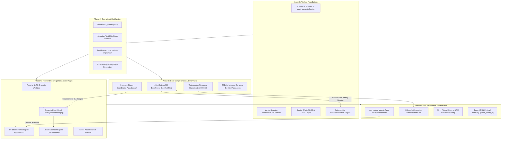

# ENCORE — Full Implementation Status & Feature Gap Audit

**Date:** November 17, 2026  
**Auditing Framework:** Multi-Agent Specialist Codebase Audit  
**Coordinating Agent:** Antigravity Coordinator  
**Specialist Auditors:**
- Agent 1 — Frontend & UX (`7cd8d001-77b5-4c49-8209-e9f68c521051`)
- Agent 2 — Backend & Data (`aff992c5-f722-4172-a20a-bf8c8de6e5b7`)
- Agent 3 — Personalization & Product (`1bdd5ba5-a1be-4f6d-88cf-37322dbd1cdd`)
- Agent 4 — Verification & Integration (`4cfea03f-63f1-4e4d-8c46-5d11a081f6ed`)

**Target Branches & Commits Inspected:**
- `main` (commit `43d052c`, base through PR #15)
- `origin/main` (commit `3adbf59`, base through PR #17, including PR #16 local data cleanup and Spotify personalization verification)
- `feature/ui-prototypes-and-spotify-sync` (commit `fe3e77d`, checked out in secondary worktree `/Users/juliankotara/.gemini/antigravity/worktrees/Encore-concert-finder/encore_index_main_site`)
- Base Proposals & Specs: `AI_HANDOFF.md`, `AGENTS.md`, `docs/index.md`, `docs/architecture/ENCORE_ARCHITECTURE_PROPOSAL_V2.md`, `docs/research/data-architecture-festival-ticketing-expansion.md`.

---

## Section 1 — Executive Summary

### 1.1 Repository Maturity Assessment
The Encore codebase exhibits an extraordinarily robust, mathematically sound, and rigorously tested **core data engine and personalization foundation**, coupled with a **significant frontend implementation gap** and **missing operational automation**.

Across the entire application, the project has achieved:
- **Rock-solid Canonical Inventory & Entity Resolution:** The PostgreSQL stored procedure `apply_canonicalization`, 3-tier event deduplication, immutable audit provenance (`raw_ingests`, `event_candidates`, `event_field_evidence`), and conservative entity resolution (Invariant 5) operate flawlessly with zero orphaned records on failure.
- **Production-Grade Independent Colorado Venue Crawlers:** Cervantes' Masterpiece Ballroom, Larimer Lounge, Lost Lake Lounge, Globe Hall, Velvet Elk Lounge, and Roots Music Project are fully implemented, verified with live CLI runners, and backed by comprehensive unit and pipeline test suites (645 passing tests).
- **Hardened Spotify OAuth & Token Crypto:** RFC 7636 PKCE, AES-256-GCM authenticated token encryption at rest, automatic proactive token refresh with clock skew buffer, and zero-client RLS are 100% complete and verified.
- **Deterministic Multi-Factor Recommendation Scorer:** Composite match scoring combining Artist Interest (50%), Distance (20%), Price (20%), and Timing (10%), backed by 4 presets and strict enforcement of Invariant 11 (disliked headliner always suppresses; favorite headliner overrides disliked support act; explicit preferences override Spotify listening signals).

### 1.2 The Largest Outstanding Gaps & Realities
1. **The Spotify Catalog Intersection Gap:**
   While the Spotify OAuth connection, top artists sync, and listening affinity scoring bridge are mathematically verified in unit tests, **the local Colorado catalog currently contains 0 verified Spotify artist IDs** (`artist_external_ids` with `provider = 'spotify'`) across 244 concerts and 579 canonical artists. Because venue scrapers extract HTML and JSON-LD text without querying Spotify URIs, live affinity scoring currently matches zero catalog shows. An automated artist enrichment service (via Spotify Web Search or MusicBrainz) is required to activate live affinity scoring.
2. **Production Homepage & Event Detail Route Missing:**
   The homepage on `main` (`app/page.tsx`) remains a minimal Phase 0 placeholder card linking to `/discover` and `/profile/taste`. The editorial "Encore Index" (`/prototypes/index`) and radar-style "Alternative Signal" (`/prototypes/signal`) exist **only as prototypes in an unmerged branch** (`feature/ui-prototypes-and-spotify-sync`). Furthermore, `main` has **no dynamic event detail page route** (`app/concerts/[id]` or `app/events/[id]`); events are viewable only as card summaries on `/discover`. An uncommitted, in-flight attempt in the secondary worktree to port the Index to `main` is currently broken with 11 TypeScript compilation errors.
3. **Saved Events & Alerts are Prototype-Only Mocks:**
   No `user_saved_events`, `user_followed_venues`, or `event_alerts` tables exist in the PostgreSQL schema. In the prototype branch, the watchlist and alert toggles operate purely on browser `localStorage`. No background alert workers, diff engines, or push/email dispatch infrastructure exists.
4. **Zero Scheduled Ingestion Automation:**
   There are **no scheduled cron jobs, GitHub Actions workflows, or edge functions** for ingestion. Ingestion occurs strictly via manual CLI command execution (`scripts/ingest-venue.ts`, `scripts/ingest-ticketmaster.ts`).
5. **Architectural Proposals vs. Reality:**
   `ENCORE_ARCHITECTURE_PROPOSAL_V2.md` specifies multi-day festival parent/child hierarchies (`parent_event_id`), verified all-in pricing columns (`is_all_in`, `pricing_status`), Ticketmaster recursive date bisection, and PostgreSQL full-text search RPCs (`search_canonical_events`). **None of these have been implemented in the codebase or database migrations.**

---

## Section 2 — Complete Feature Audit Matrix

Every feature across Categories A through L, plus additional discovered implementations, is cataloged below with a stable ID, verified status, evidence, missing work, and recommended priority.

**Status Legend:**
- `VERIFIED COMPLETE`: Code exists, connected end-to-end, and verified by passing tests or runtime execution.
- `IMPLEMENTED / UNVERIFIED`: Code exists and passes unit tests, but live data or external dependencies prevent live production verification.
- `PARTIAL`: Functional in parts, but requirements remain incomplete.
- `PROTOTYPE ONLY`: Exists only in an unmerged branch, mock fixture, or local client state.
- `NOT IMPLEMENTED`: Documented in specifications, but zero substantive code or schema exists.
- `BLOCKED`: Implementation depends on unavailable credentials, infrastructure, or prerequisites.
- `UNKNOWN`: Insufficient evidence to determine status.

| ID | Category | Feature | Status | Evidence | Missing Work | Priority |
|---|---|---|---|---|---|:---:|
| `FEAT-A01` | A. Homepage & Visual | Index UI implementation | `PROTOTYPE ONLY` | `app/prototypes/index/page.tsx`, `components/prototypes/index/Header.tsx` | Unmerged branch; worktree port has 11 TypeScript compilation errors; not wired to real catalog data | P1 |
| `FEAT-A02` | A. Homepage & Visual | Alternative Signal prototypes | `PROTOTYPE ONLY` | `app/prototypes/signal/page.tsx`, `components/prototypes/signal/*` | Unmerged branch; operates strictly on static mock fixtures | P3 |
| `FEAT-A03` | A. Homepage & Visual | Homepage recommendations | `PARTIAL` | `app/discover/page.tsx`, `lib/recommendation/service.ts` | Recommendations exist on `/discover`, but `app/page.tsx` on `main` is only a Phase 0 landing card | P1 |
| `FEAT-A04` | A. Homepage & Visual | Editorial presentation | `PROTOTYPE ONLY` | `app/prototypes/index/concerts/[id]/page.tsx` (L297–350) | "Editorial Decision Guide" driven by hardcoded mock fixture strings; no dynamic generation | P2 |
| `FEAT-A05` | A. Homepage & Visual | Event and artist imagery | `NOT IMPLEMENTED` | `components/catalog/EventCard.tsx`, `PersonalizedEventCard.tsx` | No `` or `next/image` tags rendered; `heroImageUrl` undefined across fixtures; no image CDN | P1 |
| `FEAT-A06` | A. Homepage & Visual | Image fallback hierarchy | `NOT IMPLEMENTED` | `components/catalog/` | Multi-tier fallback hierarchy (artist $\to$ venue $\to$ genre $\to$ geometric SVG) does not exist | P2 |
| `FEAT-A07` | A. Homepage & Visual | Navigation & responsive layout | `PARTIAL` | `components/prototypes/index/Header.tsx`, `app/layout.tsx` | Responsive header with drawer exists in prototype; `main` lacks unified navigation shell | P1 |
| `FEAT-A08` | A. Homepage & Visual | Audio previews | `PROTOTYPE ONLY` | `components/prototypes/index/AudioPreviewPlayer.tsx` | Playback is animated CSS simulation (`setInterval`); no real `<audio>` element or audio stream | P3 |
| `FEAT-A09` | A. Homepage & Visual | Saved-show ticker | `PROTOTYPE ONLY` | `components/prototypes/signal/SignalTicker.tsx` | Static alert ticker cycling 6 hardcoded alerts; not wired to real user watchlist | P3 |
| `FEAT-B01` | B. Search & Discovery | Artist & event search | `VERIFIED COMPLETE` | `PersonalizedDiscoverContainer.tsx#L105`, `catalog-repository.ts#L493-560` | None for current catalog scale; PostgREST multi-disjunction search works with debouncing | P1 |
| `FEAT-B02` | B. Search & Discovery | Opener / support-act search | `VERIFIED COMPLETE` | `catalog-repository.ts#L528-560` | None; queries `event_artists` across all billing positions | P2 |
| `FEAT-B03` | B. Search & Discovery | Venue search | `VERIFIED COMPLETE` | `catalog-repository.ts#L500-527`, `PersonalizedDiscoverContainer.tsx` | None; matches venue names and resolves IDs; prototype has dedicated venue dropdown | P2 |
| `FEAT-B04` | B. Search & Discovery | Genre and vibe filters | `PROTOTYPE ONLY` | `app/prototypes/index/search/page.tsx` | Absent from database schema and catalog repository; prototype filters mock string tags | P2 |
| `FEAT-B05` | B. Search & Discovery | Date/time filters | `PARTIAL` | `lib/recommendation/modes.ts` (`this_weekend`, `next_14_days`) | Server-side mode windows exist; custom calendar date-range picker and time-of-day filters missing | P2 |
| `FEAT-B06` | B. Search & Discovery | Location / radius filters | `VERIFIED COMPLETE` | `PersonalizedDiscoverContainer.tsx`, `lib/recommendation/factors/distance.ts` | None; radius buttons [15, 25, 50, 100, 200 mi] persist to profile and recalculate Haversine scores | P1 |
| `FEAT-B07` | B. Search & Discovery | Price filters | `VERIFIED COMPLETE` | `PersonalizedDiscoverContainer.tsx`, `lib/recommendation/factors/price.ts` | None for profile budget re-ranking; toolbar ad-hoc price range slider is prototype-only | P2 |
| `FEAT-B08` | B. Search & Discovery | Age restrictions | `PROTOTYPE ONLY` | `app/prototypes/index/search/page.tsx` | Absent from production schema and venue scrapers; prototype filters mock age tags | P3 |
| `FEAT-B09` | B. Search & Discovery | Personalized sorting | `VERIFIED COMPLETE` | `lib/recommendation/engine.ts`, `lib/recommendation/presets.ts` | None; 4 presets (Balanced, Artists, Nearby, Value) re-rank 0–100 composite scores deterministically | P1 |
| `FEAT-B10` | B. Search & Discovery | Alternative sorting | `PARTIAL` | `lib/recommendation/presets.ts`, prototype search | Priority presets work; traditional sort dropdown (Date Soonest, Price Low-High) is prototype-only | P2 |
| `FEAT-B11` | B. Search & Discovery | Discovery modes | `VERIFIED COMPLETE` | `lib/recommendation/modes.ts`, `components/discover/PersonalizedDiscoverContainer.tsx` | None; 4 modes (All Shows, This Weekend, Cheap & Nearby, Worth Planning) operational | P1 |
| `FEAT-B12` | B. Search & Discovery | Free-event discovery | `PARTIAL` | `lib/utils/price-formatting.ts`, `lib/recommendation/factors/price.ts` | Free shows formatted and scored 100 in price factor; quick-filter button is prototype-only | P2 |
| `FEAT-C01` | C. Personalization | Spotify OAuth PKCE Flow | `VERIFIED COMPLETE` | `lib/sources/spotify/oauth.ts`, `app/api/integrations/spotify/` | None; RFC 7636 PKCE, secure state cookie binding, and token exchange fully functional | P1 |
| `FEAT-C02` | C. Personalization | Spotify Token Storage & Crypto | `VERIFIED COMPLETE` | `supabase/migrations/20261016000000_create_user_spotify_connections.sql`, `lib/security/crypto.ts` | None; AES-256-GCM authenticated encryption at rest, zero-client RLS, admin client isolation | P1 |
| `FEAT-C03` | C. Personalization | Spotify Token Refresh Lifecycle | `VERIFIED COMPLETE` | `lib/sources/spotify/client.ts#L140-205`, `affinity-service.ts#L110-135` | None; proactive token refresh with 60s clock skew buffer, 180d reauthorization deadline | P1 |
| `FEAT-C04` | C. Personalization | Spotify Top Artists Preview | `VERIFIED COMPLETE` | `app/api/integrations/spotify/top-artists/route.ts`, `SpotifyTastePreview.tsx` | None; fetches 3 time horizons, renders trend chips, allows one-click import into profile | P1 |
| `FEAT-C05` | C. Personalization | Spotify Listening Affinity Bridge | `IMPLEMENTED / UNVERIFIED` | `lib/sources/spotify/affinity-service.ts`, `artist-interest.ts#L330-395` | Algorithm complete; **0 verified Spotify artist IDs in catalog** (matches 0 live shows) | P1 |
| `FEAT-C06` | C. Personalization | Manual Music Preferences | `VERIFIED COMPLETE` | `supabase/migrations/20261014000000_create_user_artist_preferences.sql`, `TasteProfileManager.tsx` | None; Favorite/Like/Interested/Dislike tiers, RLS, triggers handling artist deletion | P1 |
| `FEAT-C07` | C. Personalization | User Profile Preferences | `VERIFIED COMPLETE` | `supabase/migrations/20261002000000_create_profiles.sql`, `profile-repository.ts` | None; radius, 3-tier budget, and preset persist to `profiles` under RLS | P1 |
| `FEAT-C08` | C. Personalization | Genre and Vibe Preferences | `NOT IMPLEMENTED` | `SpotifyTastePreview.tsx` (cosmetic text only) | No schema columns, no user preference tables, no scoring factor integration | P3 |
| `FEAT-C09` | C. Personalization | Browsing-Based Personalization | `NOT IMPLEMENTED` | Repository search (0 hits) | Zero click tracking, view history, or implicit telemetry (deferred by privacy philosophy) | P4 |
| `FEAT-C10` | C. Personalization | Recommendation Algorithm | `VERIFIED COMPLETE` | `lib/recommendation/engine.ts`, `lib/recommendation/presets.ts` | None; deterministic 4-factor formula, 4 presets, strict [0, 100] bounds, tie-breaking | P1 |
| `FEAT-C11` | C. Personalization | Match Scores & Sub-scores | `VERIFIED COMPLETE` | `lib/recommendation/types.ts`, `PersonalizedEventCard.tsx` | None; outputs composite score and factor breakdown (artist, distance, price, timing) | P1 |
| `FEAT-C12` | C. Personalization | Recommendation Explanations | `VERIFIED COMPLETE` | `lib/recommendation/explainer.ts` | None; concise rationale strings with `·` delimiters explaining exact ranking factors | P1 |
| `FEAT-C13` | C. Personalization | Lineup Suppression & Hierarchy | `VERIFIED COMPLETE` | `lib/recommendation/factors/artist-interest.ts#L150-270` | None; Invariant 11 strictly enforced (disliked headliner suppresses; favorite overrides opener) | P1 |
| `FEAT-C14` | C. Personalization | Budget-Sensitive Scoring | `VERIFIED COMPLETE` | `lib/recommendation/factors/price.ts#L1-320` | None; multi-currency safety, verified free show rules, 5-tier piecewise budget decay | P1 |
| `FEAT-C15` | C. Personalization | User Preference Editing | `VERIFIED COMPLETE` | `app/profile/taste/actions.ts`, `TasteProfileManager.tsx` | None; live autocomplete, tier updates, preference deletion with RLS enforcement | P1 |
| `FEAT-D01` | D. Event Cards & Details | Artist & event information | `VERIFIED COMPLETE` | `PersonalizedEventCard.tsx`, `components/catalog/EventCard.tsx` | None; renders title, artists, match score (not %), and rationale strings | P1 |
| `FEAT-D02` | D. Event Cards & Details | Venue, date, and time | `VERIFIED COMPLETE` | `lib/utils/venue-date-time.ts`, `PersonalizedEventCard.tsx` | None; IANA timezone validation, localized time formatting, date_only precision handling | P1 |
| `FEAT-D03` | D. Event Cards & Details | Prices & age restrictions | `PARTIAL` | `lib/utils/price-formatting.ts`, `PersonalizedEventCard.tsx` | Price formatting verified; age restrictions absent from production database schema | P2 |
| `FEAT-D04` | D. Event Cards & Details | Headliners and opening acts | `PARTIAL` | `PersonalizedEventCard.tsx` | `billingPosition` in schema; UI renders flat comma string; visual distinction is prototype-only | P2 |
| `FEAT-D05` | D. Event Cards & Details | Event images | `NOT IMPLEMENTED` | `components/catalog/` | No event poster rendering, no asset optimization, no image CDN pipeline | P1 |
| `FEAT-D06` | D. Event Cards & Details | Event status | `VERIFIED COMPLETE` | `components/catalog/EventCard.tsx`, `PersonalizedEventCard.tsx` | None; cancelled shows strikethrough with red badge; postponed shows display amber badge | P1 |
| `FEAT-D07` | D. Event Cards & Details | Availability indicators | `PARTIAL` | `supabase/migrations/20261005120000...#L195`, parsers | Scheduled/cancelled verified; low inventory / sold out is prototype-only (coordinator gap) | P2 |
| `FEAT-D08` | D. Event Cards & Details | Event-detail pages | `PROTOTYPE ONLY` | `app/prototypes/index/concerts/[id]/page.tsx` | No `/concerts/[id]` route on `main`; detail pages exist only under prototype routes | P1 |
| `FEAT-D09` | D. Event Cards & Details | Official event links | `VERIFIED COMPLETE` | `PersonalizedEventCard.tsx`, `lib/domain/value-objects.ts` | None; URL normalization, security validation, source attribution badges, suppression on cancel | P1 |
| `FEAT-E01` | E. Ticketing & Pricing | Ticketmaster API Integration | `PARTIAL` | `lib/sources/ticketmaster/`, `scripts/ingest-ticketmaster.ts` | 1,000-event ceiling halts pagination; no recursive bisection; only fetches 1 page per run | P1 |
| `FEAT-E02` | E. Ticketing & Pricing | Primary ticket links | `VERIFIED COMPLETE` | `supabase/migrations/20261005120000...#L186`, `canonicalization-coordinator.ts` | None; normalized URLs stored in `event_ticket_links` with uniqueness constraint | P1 |
| `FEAT-E03` | E. Ticketing & Pricing | Resale ticket links | `NOT IMPLEMENTED` | Database schema inspection | Absent from schema; deferred by architectural decision to Phase 7 | P4 |
| `FEAT-E04` | E. Ticketing & Pricing | Verified all-in pricing | `NOT IMPLEMENTED` | `docs/architecture/ENCORE_ARCHITECTURE_PROPOSAL_V2.md#L288` | Proposal only; `is_all_in`, `pricing_status`, and `face_value` not in database migrations | P2 |
| `FEAT-E05` | E. Ticketing & Pricing | Free-ticket classification | `VERIFIED COMPLETE` | `lib/recommendation/factors/price.ts#L77-126`, `price-formatting.ts` | None; strict Invariant 10: numeric $0 requires verified `eventKind === 'free_event'` | P1 |
| `FEAT-E06` | E. Ticketing & Pricing | Profile price preferences | `VERIFIED COMPLETE` | `supabase/migrations/20261002000000_create_profiles.sql#L12-14` | None for 3-tier model; continuous range `[min, max]` is proposed V2 model | P1 |
| `FEAT-E07` | E. Ticketing & Pricing | Discover price overrides | `PARTIAL` | `lib/recommendation/modes.ts#L365-385` | Mode `cheap_and_nearby` filters budget; interactive toolbar price slider is prototype-only | P2 |
| `FEAT-E08` | E. Ticketing & Pricing | Outside-budget discovery | `NOT IMPLEMENTED` | `docs/architecture/ENCORE_ARCHITECTURE_PROPOSAL_V2.md#L406` | Proposal only; smooth rational decay curve and "Outside Budget" toggle not in code | P3 |
| `FEAT-E09` | E. Ticketing & Pricing | Availability & sellout detection | `PARTIAL` | Venue parsers, `canonicalization-coordinator.ts#L682` | Parsers extract `.sold-out`; **coordinator hardcodes `inventory_status: 'available'`**, dropping signal | P1 |
| `FEAT-E10` | E. Ticketing & Pricing | Presale & on-sale information | `NOT IMPLEMENTED` | Schema inspection, `lib/sources/ticketmaster/types.ts` | Ticketmaster `sales` block omitted; deferred by architectural decision to Phase 6 | P3 |
| `FEAT-F01` | F. Saved Events & Alerts | Save / watchlist functionality | `PROTOTYPE ONLY` | `lib/prototypes/store.ts`, `app/prototypes/index/saved/` | No `user_saved_events` database table or repository; operates in browser `localStorage` | P1 |
| `FEAT-F02` | F. Saved Events & Alerts | Artist and venue following | `NOT IMPLEMENTED` | Repository search (0 hits) | No `user_followed_artists` or `user_followed_venues` tables; venue following completely absent | P2 |
| `FEAT-F03` | F. Saved Events & Alerts | Presale alerts | `PROTOTYPE ONLY` | `app/prototypes/signal/watchlist/page.tsx` | Mock bell icon toggle in prototype; no alert engine or notification workers | P3 |
| `FEAT-F04` | F. Saved Events & Alerts | New-concert alerts | `NOT IMPLEMENTED` | `docs/product/alerts-and-watchlists.md` | Conceptual architecture only; no notification workers or queue | P3 |
| `FEAT-F05` | F. Saved Events & Alerts | Price-drop alerts | `PROTOTYPE ONLY` | `app/prototypes/index/saved/page.tsx` | Mock alert badge in prototype; no price diffing engine or notification delivery | P3 |
| `FEAT-F06` | F. Saved Events & Alerts | Sellout alerts | `PROTOTYPE ONLY` | `app/prototypes/signal/watchlist/page.tsx` | Mock alert badge in prototype; no inventory monitor | P3 |
| `FEAT-F07` | F. Saved Events & Alerts | Cancellation notifications | `NOT IMPLEMENTED` | Repository search (0 hits) | Canonical cancellations captured, but zero notification push infrastructure exists | P2 |
| `FEAT-F08` | F. Saved Events & Alerts | Weekly digests | `NOT IMPLEMENTED` | Repository search (0 hits) | No email template generation or batch dispatch service | P3 |
| `FEAT-F09` | F. Saved Events & Alerts | Notification preferences | `NOT IMPLEMENTED` | Schema inspection | No `user_notification_preferences` table or settings UI | P2 |
| `FEAT-G01` | G. Calendar & Planning | Calendar view | `NOT IMPLEMENTED` | App directory inspection | Zero calendar grid views or components in `main` or prototypes | P2 |
| `FEAT-G02` | G. Calendar & Planning | Weekly/monthly layouts | `NOT IMPLEMENTED` | App directory inspection | No weekly or monthly agenda schedule views implemented | P2 |
| `FEAT-G03` | G. Calendar & Planning | Saved events in calendar | `NOT IMPLEMENTED` | App directory inspection | No saved event overlay onto calendar layouts | P2 |
| `FEAT-G04` | G. Calendar & Planning | Apple Calendar export (.ics) | `NOT IMPLEMENTED` | App directory inspection | RFC 5545 `.ics` file generator not implemented | P1 |
| `FEAT-G05` | G. Calendar & Planning | Google Calendar export | `NOT IMPLEMENTED` | App directory inspection | Web `calendar.google.com/render?action=TEMPLATE` generator not implemented | P1 |
| `FEAT-G06` | G. Calendar & Planning | Personal calendar integration | `NOT IMPLEMENTED` | Repository search (0 hits) | No Google Calendar / Apple CalDAV two-way OAuth or sync | P4 |
| `FEAT-G07` | G. Calendar & Planning | Calendar conflict detection | `NOT IMPLEMENTED` | Repository search (0 hits) | No conflict detection against personal schedules or overlapping saved shows | P3 |
| `FEAT-G08` | G. Calendar & Planning | Festival calendar support | `NOT IMPLEMENTED` | App directory inspection | Enum `multi_day_festival` exists; zero timetable or stage schedule UI exists | P3 |
| `FEAT-H01` | H. Reviews & Attendance | Artist reviews | `NOT IMPLEMENTED` | `docs/product/attended-concerts-and-reviews.md` | Deferred post-MVP; no database tables or UI | P4 |
| `FEAT-H02` | H. Reviews & Attendance | Venue reviews | `NOT IMPLEMENTED` | `docs/product/attended-concerts-and-reviews.md` | Deferred post-MVP; no database tables or UI | P4 |
| `FEAT-H03` | H. Reviews & Attendance | Artist-venue combination reviews | `NOT IMPLEMENTED` | `docs/product/attended-concerts-and-reviews.md` | Deferred post-MVP; no database tables or UI | P4 |
| `FEAT-H04` | H. Reviews & Attendance | Past attendance history | `NOT IMPLEMENTED` | `docs/product/attended-concerts-and-reviews.md` | Deferred post-MVP; no `user_event_attendance` table or logging UI | P4 |
| `FEAT-H05` | H. Reviews & Attendance | Private/public review controls | `NOT IMPLEMENTED` | `docs/product/attended-concerts-and-reviews.md` | Deferred post-MVP; no privacy flags or schema | P4 |
| `FEAT-H06` | H. Reviews & Attendance | Reviews incorporated into scoring | `NOT IMPLEMENTED` | `docs/product/attended-concerts-and-reviews.md` | Deferred post-MVP; no feedback loops in recommendation engine | P4 |
| `FEAT-I01` | I. Event Coverage | Cervantes' Masterpiece Ballroom | `VERIFIED COMPLETE` | `lib/sources/venue/cervantes/`, `scripts/ingest-venue.ts` | None; live HTML scraping, room splitting (Ballroom vs Other Side), and persistence verified | P1 |
| `FEAT-I02` | I. Event Coverage | Larimer Lounge | `VERIFIED COMPLETE` | `lib/sources/venue/independent-venue-group/` | None; crawls calendar, extracts show times and SeeTickets links, persists canonically | P1 |
| `FEAT-I03` | I. Event Coverage | Lost Lake Lounge | `VERIFIED COMPLETE` | `lib/sources/venue/independent-venue-group/` | None; Colfax club concerts, times, and ticket links parsed and persisted | P1 |
| `FEAT-I04` | I. Event Coverage | Globe Hall | `VERIFIED COMPLETE` | `lib/sources/venue/independent-venue-group/` | None; barbecue/music events, times, and ticket links parsed and persisted | P1 |
| `FEAT-I05` | I. Event Coverage | Velvet Elk Lounge | `VERIFIED COMPLETE` | `lib/sources/venue/velvet-elk/`, `tests/unit/boulder-venues-*.test.ts` | None; BentoBox crawler, detail URL security guard, subpage JSON-LD enrichment verified | P1 |
| `FEAT-I06` | I. Event Coverage | Roots Music Project | `VERIFIED COMPLETE` | `lib/sources/venue/roots-music-project/` | None; Eventbrite `__NEXT_DATA__` JSON crawler with DJ/showcase filter verified | P1 |
| `FEAT-I07` | I. Event Coverage | Z2 Entertainment (Boulder/Fox/Aggie) | `NOT IMPLEMENTED` | `AI_HANDOFF.md#L57,67` | Planned for PR #16; no adapter, parser, or registry entry implemented | P1 |
| `FEAT-I08` | I. Event Coverage | Major Colorado Venues | `PARTIAL` | `scripts/ingest-ticketmaster.ts` (`--state=CO`) | Ingested indirectly via Ticketmaster; no direct scrapers for AEG venues (Mission, Red Rocks) | P2 |
| `FEAT-I09` | I. Event Coverage | Colorado Mountain Venues | `NOT IMPLEMENTED` | `docs/architecture/ENCORE_ARCHITECTURE_PROPOSAL_V2.md#L376` | No direct adapters for Belly Up Aspen, Ford Amphitheater Vail, or Dillon Amphitheater | P2 |
| `FEAT-I10` | I. Event Coverage | Regional Coverage (UT, WY, NM, etc.) | `PARTIAL` | `scripts/ingest-ticketmaster.ts` (`--state=...`) | Manual CLI parameter supported; no automated regional rolling sweep runner | P2 |
| `FEAT-I11` | I. Event Coverage | National Events and Venues | `PARTIAL` | `lib/sources/ticketmaster/client.ts` | Ad-hoc keyword/state queries supported; no automated national crawl or tour tracker | P3 |
| `FEAT-I12` | I. Event Coverage | Venue Ingestion Framework | `VERIFIED COMPLETE` | `lib/sources/venue/http-client.ts`, `date-time.ts`, `jsonld-extractor.ts` | None; reusable HTTP client with redirect validation, wall-clock time parsing, Cheerio JSON-LD | P1 |
| `FEAT-I13` | I. Event Coverage | Venue Source Reliability | `PARTIAL` | `sources` table, `lib/repositories/source-repository.ts` | Failure counts recorded; zero-event parser anomaly detection and auto-deactivation missing | P2 |
| `FEAT-J01` | J. Festivals | National Festival Inventory | `NOT IMPLEMENTED` | `docs/architecture/ENCORE_ARCHITECTURE_PROPOSAL_V2.md#L383` | Proposal only; zero curated festival registry seeds or dedicated sweep adapters | P2 |
| `FEAT-J02` | J. Festivals | Multi-day Event Support | `VERIFIED COMPLETE` | `supabase/migrations/20261005120000...#L121`, `lib/domain/catalog.ts` | None for single-event representation (`is_multi_day`, `local_start_date`, `local_end_date`) | P1 |
| `FEAT-J03` | J. Festivals | Parent/child festival hierarchy | `NOT IMPLEMENTED` | `docs/architecture/ENCORE_ARCHITECTURE_PROPOSAL_V2.md#L253` | Proposal only; `parent_event_id` does NOT exist in database migrations | P2 |
| `FEAT-J04` | J. Festivals | Daily festival lineups | `NOT IMPLEMENTED` | Database schema inspection | Lineup attaches in flat list to root event; cannot split by day without `parent_event_id` | P2 |
| `FEAT-J05` | J. Festivals | Day-specific match scores | `NOT IMPLEMENTED` | `lib/recommendation/engine.ts` | Engine scores monolithic event; cannot score individual festival days | P2 |
| `FEAT-J06` | J. Festivals | Festival ticket options | `NOT IMPLEMENTED` | `docs/architecture/ENCORE_ARCHITECTURE_PROPOSAL_V2.md#L21` | Intentionally deferred; upstream APIs do not publish structured tier options | P4 |
| `FEAT-J07` | J. Festivals | Lineup-change tracking | `NOT IMPLEMENTED` | Database schema inspection | `lineup_phase` not in database; no audit table for dropped/added acts | P3 |
| `FEAT-J08` | J. Festivals | Multi-venue festivals | `NOT IMPLEMENTED` | Database schema inspection | Cannot cluster independent club shows under a parent festival entity | P3 |
| `FEAT-K01` | K. Infrastructure & APIs | Ticketmaster Ingestion Reliability | `PARTIAL` | `lib/sources/ticketmaster/client.ts#L62-85` | Rate limiter and backoff work; deep pagination halts when `page * size >= 1000` | P1 |
| `FEAT-K02` | K. Infrastructure & APIs | API Quota Handling | `NOT IMPLEMENTED` | `docs/architecture/ENCORE_ARCHITECTURE_PROPOSAL_V2.md#L113` | Reactive HTTP 429 backoff only; no daily request counting or quota circuit breaker | P2 |
| `FEAT-K03` | K. Infrastructure & APIs | Scheduled Synchronization | `NOT IMPLEMENTED` | `.github/workflows/` inspection | Zero cron workflows or edge triggers; all ingestion is manual CLI execution | P1 |
| `FEAT-K04` | K. Infrastructure & APIs | Event Deduplication | `VERIFIED COMPLETE` | `supabase/migrations/20261005120001...#L20`, `event-matcher.ts` | None; 3-tier deduplication (source URL hash, candidate fingerprint, event matcher) verified | P1 |
| `FEAT-K05` | K. Infrastructure & APIs | Entity Resolution | `VERIFIED COMPLETE` | `lib/entity-resolution/`, `apply_canonicalization` procedure | None; external ID precedence, artist name collision routing, atomic stored procedure | P1 |
| `FEAT-K06` | K. Infrastructure & APIs | Search Performance & FTS | `PARTIAL` | `lib/repositories/catalog-repository.ts#L492-588` | PostgREST `.or(...)` query works for current scale; PostgreSQL `tsvector` + GIN not implemented | P2 |
| `FEAT-K07` | K. Infrastructure & APIs | Spatial Search | `PARTIAL` | `lib/recommendation/factors/distance.ts` | In-memory Haversine distance scoring complete; PostGIS `geography` column and GiST missing | P2 |
| `FEAT-K08` | K. Infrastructure & APIs | Supabase Storage Lifecycle | `NOT IMPLEMENTED` | `docs/project/non-blocking-debt.md#L46` | Stored in PostgreSQL `raw_content` text column; object storage bucket & compaction deferred | P3 |
| `FEAT-K09` | K. Infrastructure & APIs | Database Security & RLS | `VERIFIED COMPLETE` | `supabase/migrations/20261005120002_secure_inventory_tables.sql`, `destination-guard.ts` | None; RLS across all 15 public tables, service_role isolation, destination guard verified | P1 |
| `FEAT-K10` | K. Infrastructure & APIs | Ingestion Monitoring & Telemetry | `PARTIAL` | `sources` table, CLI runners | Failure counts recorded in database; real-time Sentry/Slack alerting and anomaly detection missing | P2 |
| `FEAT-K11` | K. Infrastructure & APIs | Data Provenance | `VERIFIED COMPLETE` | `supabase/migrations/20261005120001...`, `event_field_evidence` | None; field-level source attribution, confidence tracking, and candidate audit preserved | P1 |
| `FEAT-K12` | K. Infrastructure & APIs | Timezone Correctness | `VERIFIED COMPLETE` | `lib/utils/venue-date-time.ts`, `tests/unit/venue-date-time.test.ts` | None; Invariant 10 enforced: local calendar dates computed in validated venue IANA timezone | P1 |
| `FEAT-L01` | L. Development | CI/CD | `PARTIAL` | `.github/workflows/ci.yml` | Comprehensive PR CI green in GitHub Actions; continuous deployment and scheduled sync missing | P1 |
| `FEAT-L02` | L. Development | Automated Test Suites | `VERIFIED COMPLETE` | `vitest.config.ts`, `tests/unit/`, `tests/integration/`, `tests/e2e/` | 645/645 unit tests pass in-memory; integration tests require Docker; E2E passes in CI | P1 |
| `FEAT-L03` | L. Development | Production Build Readiness | `VERIFIED COMPLETE` | `next.config.ts`, `package.json` | Next.js 15.5.27 compiles 14 production routes in 2.6s with 103 kB shared bundle | P1 |
| `FEAT-L04` | L. Development | Environment Configuration | `VERIFIED COMPLETE` | `lib/env/server.ts`, `lib/env/public.ts`, `.env.example` | Runtime Zod schema validation; 64-hex encryption key validation; safe fallbacks | P1 |
| `FEAT-L05` | L. Development | Branch & Worktree Reconciliation | `PARTIAL` | `git status`, `git branch -a`, worktrees | Local `main` 2 commits behind `origin/main`; worktree prototype port has 11 TS errors | P1 |
| `FEAT-L06` | L. Development | Technical Debt Tracking | `VERIFIED COMPLETE` | `docs/project/non-blocking-debt.md` | Well-documented debt log across database, ingestion, search, and frontend | P2 |
| `FEAT-L07` | L. Development | Deployment Blockers | `PARTIAL` | Repo inspection | Prettier check fails on `.backup/`; missing hosted Supabase and Vercel CD pipelines | P1 |
| `FEAT-X01` | Additional | Encore Project Hub (`/hub`) | `VERIFIED COMPLETE` | `app/hub/page.tsx`, `components/hub/` | None; internal operational dashboard for inspecting catalog and source statistics | P2 |
| `FEAT-X02` | Additional | Safe Destination Guard | `VERIFIED COMPLETE` | `lib/supabase/destination-guard.ts` | None; blocks accidental writes to non-local or production databases during testing | P1 |
| `FEAT-X03` | Additional | Synthetic Catalog Data Cleanup | `VERIFIED COMPLETE` | `scripts/cleanup-synthetic-data.ts` | None; read-only provenance-based diagnostic tool protecting authentic Colorado venue data | P2 |
| `FEAT-X04` | Additional | Detail URL Security Guard | `VERIFIED COMPLETE` | `lib/sources/venue/velvet-elk/adapter.ts`, `VenueHttpClient` | None; pre-request redirect validation prevents SSRF and external ticketing traversal | P1 |

---

## Section 3 — Verified Implemented Features

These features have substantive implementation in `main` / `origin/main`, are wired to PostgreSQL or external services, and have passing automated verification tests:

1. **Deterministic Multi-Factor Recommendation Scorer (`FEAT-C10`, `FEAT-C11`, `FEAT-C12`):**
   Pure, explainable scoring formula in `lib/recommendation/engine.ts` combining Artist Interest, Distance, Price, and Timing. Four presets (`balanced`, `artist_first`, `nearby`, `value`). Outputs concise, human-readable rationale strings.
2. **Lineup Suppression & Artist Preference Hierarchy (`FEAT-C13`):**
   Invariant 11 is strictly enforced in `lib/recommendation/factors/artist-interest.ts`. A disliked headliner suppresses the event; a favorite headliner overrides disliked support acts; explicit preferences override Spotify listening signals.
3. **Manual Music Preferences (`FEAT-C06`, `FEAT-C15`):**
   Full CRUD operations in `app/profile/taste/actions.ts` and `TasteProfileManager.tsx` backed by `public.user_artist_preferences` with RLS. Database triggers preserve history on canonical artist deletion without orphaned rows.
4. **Spotify OAuth 2.0 PKCE & Token Cryptography (`FEAT-C01`, `FEAT-C02`, `FEAT-C03`, `FEAT-C04`):**
   RFC 7636 PKCE flow in `lib/sources/spotify/oauth.ts`, AES-256-GCM token encryption at rest with randomized IVs in `lib/security/crypto.ts`, zero-client RLS, proactive token refresh with clock skew buffer in `lib/sources/spotify/client.ts`, and 3-horizon top artists preview in `SpotifyTastePreview.tsx`.
5. **Colorado Independent Venue Crawlers (`FEAT-I01` through `FEAT-I06`, `FEAT-I12`):**
   Full scraping pipelines for Cervantes' Masterpiece Ballroom, Larimer Lounge, Lost Lake, Globe Hall, Velvet Elk Lounge, and Roots Music Project. Verified against live websites and static HTML fixtures via `scripts/ingest-venue.ts`. Detail URL security guards and Eventbrite DJ showcase filters prevent false artist generation.
6. **Canonical Ingestion & Deduplication Pipeline (`FEAT-E02`, `FEAT-K04`, `FEAT-K05`, `FEAT-K09`, `FEAT-K11`, `FEAT-K12`):**
   Atomic canonicalization inside PostgreSQL stored procedure `apply_canonicalization`. 3-tier deduplication, external ID precedence, field-level provenance tracking in `event_field_evidence`, strict RLS across 15 public tables, and IANA timezone date computation.
7. **Production Search & Discovery (`FEAT-B01`, `FEAT-B02`, `FEAT-B03`, `FEAT-B06`, `FEAT-B07`, `FEAT-B09`, `FEAT-B11`):**
   Debounced artist, opener, and venue search on `/discover`. Travel radius and ticket budget preference updates persisted via Server Actions. 4 operational discovery modes (`all`, `this_weekend`, `cheap_and_nearby`, `worth_planning_for`).
8. **Production Build & Environment Verification (`FEAT-L02`, `FEAT-L03`, `FEAT-L04`, `FEAT-X02`):**
   Next.js 15.5.27 compiles 14 routes with 0 TypeScript and 0 ESLint errors. Strict runtime Zod environment validation. 645 in-memory unit tests passing in ~14s. Destination guard prevents accidental writes to production databases.

---

## Section 4 — Partially Implemented Features

These features have foundational code in the repository, but require specific engineering actions to become fully complete:

1. **Spotify Catalog Intersection (`FEAT-C05`):**
   - *What Works:* `lib/sources/spotify/affinity-service.ts` caches Spotify top artists and scores them in `lib/recommendation/factors/artist-interest.ts` (60–70 score).
   - *Missing Work:* The 244 Colorado concerts have **0 verified Spotify artist IDs** in `artist_external_ids`. An automated artist enrichment service (querying the Spotify Search API or MusicBrainz) must be implemented during ingestion to link canonical artists to Spotify IDs.
2. **Ticketmaster Ingestion Deep Pagination (`FEAT-E01`, `FEAT-K01`):**
   - *What Works:* Authenticated API client, 2 req/sec queue, 429 backoff, parser, and canonicalization runner.
   - *Missing Work:* Client throws `TicketmasterValidationError` when `page * size >= 1000`. Recursive date bisection (Dynamic Temporal Partitioning) must be implemented in `lib/sources/ticketmaster/client.ts` to paginate past 1,000 events.
3. **Ticket Availability & Sellout Coordinator Gap (`FEAT-E09`, `FEAT-D07`):**
   - *What Works:* Venue parsers extract `.sold-out` CSS classes and store `isSoldOut: true` in `rawPayload`. `event_ticket_links.inventory_status` column exists in the database.
   - *Missing Work:* `CanonicalizationCoordinator` hardcodes `inventory_status: 'available'`, silently discarding the parsed sellout signal. `EventCandidate` must be updated with `inventoryStatus`, passed through coordinator, and rendered as a "Sold Out" badge in UI.
4. **CI/CD & Operational Ingestion (`FEAT-L01`, `FEAT-K03`):**
   - *What Works:* GitHub Actions PR workflow runs tests, lint, typecheck, and build.
   - *Missing Work:* Zero automated cron workflows exist. A `.github/workflows/scheduled-ingest.yml` must be authored to run rolling venue and Ticketmaster syncs automatically.
5. **Full-Text & Spatial Search Scalability (`FEAT-K06`, `FEAT-K07`):**
   - *What Works:* PostgREST search queries and in-memory Haversine distance scoring work cleanly at current scale (~250 events).
   - *Missing Work:* PostgreSQL `tsvector` + GIN full-text search RPC (`search_canonical_events`) and PostGIS `geography` columns are needed before national catalog scaling.
6. **Date & Free Event Discovery Controls (`FEAT-B05`, `FEAT-B12`, `FEAT-E07`):**
   - *What Works:* Backend date windows and free event scoring ($0 with verified status = 100) are operational.
   - *Missing Work:* Interactive calendar date-range picker, dedicated "Free Shows ($0)" quick-filter chip, and session price slider are missing from the production Discover toolbar.
7. **Major Venue Ingestion Coverage (`FEAT-I08`, `FEAT-I10`):**
   - *What Works:* Major Colorado Ticketmaster events can be ingested via CLI.
   - *Missing Work:* Direct scrapers for AEG/AXS venues (Mission Ballroom, Red Rocks, Ogden, Bluebird, Gothic) are not built.

---

## Section 5 — Prototype-Only Features

These features exist in the unmerged `feature/ui-prototypes-and-spotify-sync` branch (`encore_index_main_site` worktree) or operate purely on client-side mock fixtures:

1. **"Encore Index" Editorial Homepage (`FEAT-A01`, `FEAT-A03`, `FEAT-A07`):**
   - *Location:* `app/prototypes/index/page.tsx`, `components/prototypes/index/*`.
   - *State:* Rich editorial homepage with hero search, mode switchers, and curated collection carousels. Operates on mock fixtures in `lib/prototypes/fixtures.ts`.
   - *Worktree Drift:* An uncommitted attempt in the secondary worktree to port the Index to `app/page.tsx` currently fails typecheck with **11 TypeScript compilation errors** (array indexing on RecommendationResult, null region mismatches, missing venue lat/lng, and invalid preference levels).
2. **"Alternative Signal" Dark Radar Interface (`FEAT-A02`, `FEAT-A09`):**
   - *Location:* `app/prototypes/signal/page.tsx`, `components/prototypes/signal/*`.
   - *State:* Dark-mode radar UI with `HeroSignal`, `QuickScannerBand`, 5 horizontal signal streams, and an animated 6-alert marquee ticker. Operates entirely on static fixtures.
3. **Event Detail Pages (`FEAT-D08`, `FEAT-A04`):**
   - *Location:* `app/prototypes/index/concerts/[id]/page.tsx`, `app/prototypes/signal/concerts/[id]/page.tsx`.
   - *State:* Rich concert detail pages featuring an "Editorial Decision Guide" ("Why This Suits You", "What to Consider"), lineup cards, and ticket links. Driven by hardcoded mock strings. `main` has no dynamic `/concerts/[id]` route.
4. **Saved Shows Watchlist & Alert Toggles (`FEAT-F01`, `FEAT-F03`, `FEAT-F05`, `FEAT-F06`):**
   - *Location:* `app/prototypes/index/saved/page.tsx`, `app/prototypes/signal/watchlist/page.tsx`, `lib/prototypes/store.ts`.
   - *State:* Toggling the heart icon or bell icon modifies `savedEventIds` and `alertEventIds` arrays in browser `localStorage`. No database tables, repositories, or server actions exist.
5. **Audio Preview Player (`FEAT-A08`):**
   - *Location:* `components/prototypes/index/AudioPreviewPlayer.tsx`.
   - *State:* Visual playback simulation using `setInterval` progress animation. No HTML5 `<audio>` element or live audio streaming.
6. **Granular Search Filters (`FEAT-B04`, `FEAT-B08`, `FEAT-B10`):**
   - *Location:* `app/prototypes/index/search/page.tsx`.
   - *State:* Genre dropdown, age restriction chips (`all_ages`, `18+`, `21+`), and traditional sort dropdowns (Date Soonest, Price Low-to-High) filtering client mock arrays.

---

## Section 6 — Not Implemented

These features are planned in product specifications or architectural proposals, but have **zero substantive code or database migrations** in the repository:

1. **Calendar & Planning Subsystem (`FEAT-G01` through `FEAT-G08`):**
   - 100% unbuilt. No calendar grid views, weekly/monthly timelines, Apple Calendar `.ics` exports, Google Calendar URL generators, personal CalDAV integrations, conflict detectors, or festival timetable schedule builders.
2. **Concert Attendance & Experience Reviews (`FEAT-H01` through `FEAT-H06`):**
   - No `user_event_attendance`, `user_venue_reviews`, or `user_artist_live_reviews` tables. Explicitly documented as approved post-MVP direction in `docs/product/attended-concerts-and-reviews.md`.
3. **Parent/Child Festival Hierarchy (`FEAT-J01`, `FEAT-J03` through `FEAT-J08`):**
   - Proposed in `ENCORE_ARCHITECTURE_PROPOSAL_V2.md`, but `parent_event_id` does NOT exist in database migrations. Multi-day festivals are stored as flat monolithic rows; cannot split lineups or score by day.
4. **Verified All-In Pricing Columns (`FEAT-E04`, `FEAT-E08`):**
   - `is_all_in`, `pricing_status`, `face_value`, and continuous rational decay curve do not exist in the database or recommendation factors.
5. **Entity Following & Alert Dispatch Infrastructure (`FEAT-F02`, `FEAT-F04`, `FEAT-F07`, `FEAT-F08`, `FEAT-F09`):**
   - No `user_followed_venues` or notification preferences schema; zero email/push alert worker queues or dispatch services.
6. **Z2 Entertainment Venue Scrapers (`FEAT-I07`):**
   - Boulder Theater, Fox Theatre, and Aggie Theatre scrapers (`z2ent.com`) have not been implemented.
7. **Event Poster Artwork Pipeline (`FEAT-A05`, `FEAT-A06`, `FEAT-D05`):**
   - No event poster ingestion, no image storage bucket, and no multi-tier image fallback ladder.
8. **API Quota Management & Automated Lifecycle (`FEAT-K02`, `FEAT-K08`):**
   - No daily Ticketmaster quota tracking database or circuit breaker; no 30-day raw ingest compaction pruning cron.

---

## Section 7 — Architecture Readiness

### 7.1 Scalability & Extensibility Evaluation
Can the existing architecture support future roadmap milestones without major restructuring?

- **Database Core: READY.** The canonical schema (`events`, `artists`, `venues`, `event_artists`, `event_ticket_links`), provenance auditing (`raw_ingests`, `event_candidates`), and the atomic `apply_canonicalization` stored procedure are enterprise-grade. Extending `events` with `parent_event_id` or `event_ticket_links` with `is_all_in` requires only clean, backward-compatible `ALTER TABLE` migrations.
- **Ingestion Framework: READY.** The venue scraping architecture (`VenueHttpClient`, Cheerio/JSON-LD parsing, wall-clock timezone normalization) is modular, secure against SSRF/redirect loops, and easily extensible to new venues.
- **Recommendation Engine: READY.** The 4-factor scoring engine (`lib/recommendation/engine.ts`) is cleanly decoupled, deterministic, and pure. Adding new factors (e.g. venue affinity or continuous pricing decay) requires only implementing a factor calculator conforming to `FactorResult`.
- **Search Layer: NEEDS REFACTORING BEFORE NATIONAL SCALE.** PostgREST `.or(...)` queries are sufficient for current Colorado volumes (<500 events), but will encounter HTTP 414 URI length limits and latency spikes at national scale (>10,000 events). Deploying the proposed PostgreSQL `search_canonical_events` RPC with GIN indexing is necessary before expanding beyond Colorado.
- **Frontend Architecture: REQUIRES CONVERGENCE.** The split between production routes (`/discover`) and unmerged prototype routes (`/prototypes/index`, `/prototypes/signal`) has created dual maintenance. Migrating the production shell to the editorial Index design is the primary frontend requirement.

---

## Section 8 — Critical Blockers and Technical Debt

### 8.1 Critical Deployment Blockers
1. **Prettier Check Failure:**
   `npm run format:check` currently fails because `.backup/synthetic-cleanup-backup-*.json` files were added to `.gitignore` but omitted from `.prettierignore`. (Remediation: Add `.backup/` and `scratch/` to `.prettierignore`).
2. **Worktree Prototype Port Compilation Errors:**
   The uncommitted draft in `/Users/juliankotara/.gemini/antigravity/worktrees/Encore-concert-finder/encore_index_main_site` has 11 TypeScript compilation errors. This branch must not be merged until type errors are resolved.
3. **Missing Automated CD Pipeline:**
   `.github/workflows/` contains PR verification (`ci.yml`), but zero deployment workflows to Vercel or Supabase Cloud.

### 8.2 High-Priority Technical Debt
1. **Integration Test Silent Passes:**
   In `tests/integration/`, 5 suites execute `if (!isDbAvailable) return;` inside test cases. When Docker is offline, Vitest reports 50 tests as "passed" instead of skipped. (Remediation: Refactor to `describe.skipIf(!isDbAvailable)`).
2. **Manual TypeScript Database Types:**
   Repositories rely on manually written TypeScript interfaces (`ArtistRow`, `VenueRow`), risking compile-time drift from PostgreSQL schema. (Remediation: Add `supabase gen types typescript`).
3. **Inventory Status Coordinator Disconnection:**
   Venue scrapers parse `.sold-out` classes, but `CanonicalizationCoordinator` hardcodes `inventory_status: 'available'`, discarding the sellout signal.
4. **Scraper Zero-Event Anomaly Risk:**
   If a venue changes its HTML layout and the scraper returns 0 events, `ingestion-pipeline.ts` records a successful fetch. A "Suspect Parser Failure" anomaly check is needed.

---

## Section 9 — Implementation Dependency Map

---

## Section 10 — Recommended Implementation Sequence

Based on verified repository reality, here is the sequenced development roadmap distinguishing necessary prerequisites from parallelizable tasks:

### Milestone 1: Operational Hygiene & Test Integrity (Immediate)
- **1.1:** Add `.backup/` and `scratch/` to `.prettierignore` to restore green `npm run format:check`.
- **1.2:** Fast-forward local `main` to `origin/main` (incorporating PR #16 data cleanup and PR #17 security sanitization).
- **1.3:** Refactor integration tests to use `describe.skipIf(!isDbAvailable)` to eliminate false-positive test passes when Docker is down.
- **1.4:** Add `db:types` script using `supabase gen types typescript` to lock TypeScript types to database migrations.

### Milestone 2: Frontend Convergence & Event Detail Pages (Parallelizable with Milestone 3)
- **2.1:** Fix the 11 TypeScript compilation errors in the `encore_index_main_site` worktree.
- **2.2:** Port the "Encore Index" layout to `app/page.tsx`, wiring it to `getPersonalizedDiscoverData()` and `getPublicDiscoverData()`.
- **2.3:** Implement the dynamic event detail route `app/concerts/[id]/page.tsx` backed by `catalogRepo.getEventById(id)`.
- **2.4:** Implement 1-click calendar exports: Apple Calendar `.ics` download (RFC 5545) and Google Calendar web link.
- **2.5:** Fix the `CanonicalizationCoordinator` inventory status gap so parsed `.sold-out` events display "Sold Out" badges in UI.

### Milestone 3: Live Personalization & Ingestion Scaling (Parallelizable with Milestone 2)
- **3.1 Spotify Artist Enrichment Service:** Build an automated artist resolution step during ingestion (querying Spotify Web API `/v1/search?type=artist`) to associate canonical artists with Spotify URIs in `artist_external_ids`, immediately unlocking live listening affinity scoring.
- **3.2 Ticketmaster Recursive Bisection:** Implement Dynamic Temporal Partitioning in `TicketmasterApiClient` to eliminate the 1,000-event ceiling.
- **3.3 Z2 Entertainment Ingestion (PR #16):** Implement `Z2VenueAdapter` targeting Boulder Theater, Fox Theatre, and Aggie Theatre (`z2ent.com/events`) with AXS ticketing.
- **3.4 Ingestion Anomaly Detection:** Add a zero-event anomaly guard to `venue/ingestion-pipeline.ts` to prevent recording success when a layout change breaks a scraper.

### Milestone 4: User Persistence & Automation (Next Phase)
- **4.1 Persistent Watchlist:** Create migration `public.user_saved_events` with RLS, repository, and Server Actions. Replace prototype `localStorage` state with database-backed saved shows.
- **4.2 Scheduled Ingestion Cron:** Create `.github/workflows/scheduled-ingest.yml` executing rolling venue and Ticketmaster syncs daily.
- **4.3 Event Artwork Pipeline:** Ingest high-res poster URLs into `canonical_events` and add Next.js `<Image>` components with multi-tier fallback placeholders.
- **4.4 All-In Pricing:** Apply schema migration adding `is_all_in` and `pricing_status` to `event_ticket_links`; pass `allInclusivePricing=true` in Ticketmaster requests.
- **4.5 Festival Hierarchy:** Apply schema migration adding `parent_event_id` to `events` to support multi-day daily lineup splits.

---

## Section 11 — Verification Limitations

The findings in this report were verified using strict read-only static analysis, code inspection, Git history tracing, and local automated test suites. The following limitations apply:

1. **Docker / Local Supabase Availability:**
   During local test execution, the local Supabase Docker daemon was not running. Integration tests (`tests/integration/*.test.ts`) were verified via GitHub Actions CI logs on pinned Ubuntu runners rather than a live local PostgreSQL instance.
2. **macOS Sandbox Loopback Socket Restrictions:**
   Playwright browser tests (`tests/e2e/*.spec.ts`) fail locally in macOS sandboxed environments with `net::ERR_ACCESS_DENIED` on `127.0.0.1:3000`. E2E functionality was verified via GitHub Actions CI test runs.
3. **Spotify Live User Auth & Developer Mode:**
   Spotify OAuth connection and affinity scoring were verified through cryptographic unit tests and synthetic preview fixtures. Testing with live Spotify accounts requires developer email allowlisting in the Spotify Developer Dashboard while in Development Mode.
4. **Live Ticketmaster API Rate Limiting:**
   Ticketmaster ingestion was verified using dry-run fixture replay and client unit tests. Broad live multi-state crawling was not executed to prevent consuming daily API request quota.
