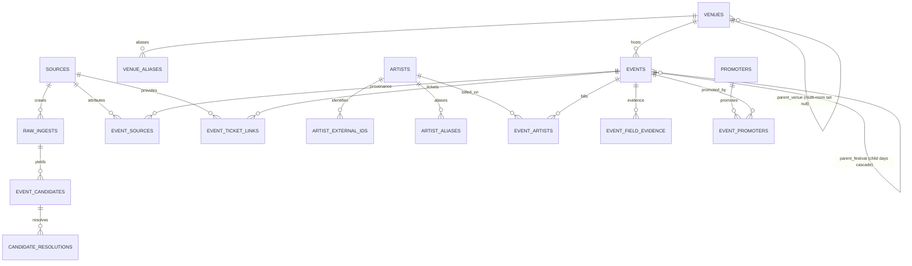
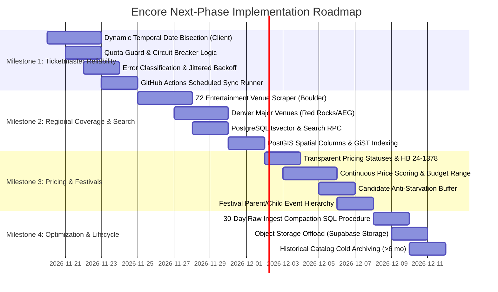

# ENCORE — Unified Backend Architecture Proposal (Revision 2)
## Next-Phase Architecture Specification: Ticketmaster Ingestion, Regional Scaling, Festival Hierarchy, and Transparent Pricing

**Author:** Antigravity Architecture Lead & Specialist Agents (API Integration, Data Architecture, Search & Pricing, Systems Review)  
**Date:** November 2026  
**Status:** REVISED PROPOSAL (V2) — Ready for External Review  
**Target Repository:** `Encore-concert-finder` (Next.js 15 App Router, Supabase PostgreSQL, TypeScript)  
**Base Branches:** `main` (through PR #17, commit `3adbf59`) / Base Worktree `encore_architecture_proposal` (`43d052c`)

---

## Executive Change Summary (V1 $\to$ V2 Revisions)

Following external architectural review of `ENCORE_ARCHITECTURE_PROPOSAL.md`, this revised proposal (`V2`) implements eight major course corrections:

| Review Finding | V1 Proposal (Previous) | V2 Revised Architecture (Current) | Rationale for Revision |
| :--- | :--- | :--- | :--- |
| **1. Pricing Estimates** | Speculative estimated fee formula ($\min(P \times 0.20 + 4, P \times 0.35)$). | **Zero speculative fee estimates.** Authoritative 5-tier pricing status taxonomy (`verified_all_in`, `base_face_value`, `unknown`, `unavailable_tba`, `free_verified`). Verified Ticketmaster `allInclusivePricing` boolean support. | Eliminates deceptive price guesswork. Conforms strictly with Colorado HB 24-1378 and FTC Part 464 for discovery platforms. |
| **2. Budget Preferences & Scoring** | Single budget ceiling with discontinuous step drops and a rigid $1.5\times$ cutoff in `cheap_and_nearby`. | **Preferred price range `[preferred_min_price, preferred_max_price]` with no absolute ceiling.** Differentiable ($C^1$) smooth rational decay curve. "Outside Budget" control allows all higher-priced events. | Fixes mathematical jump discontinuities; allows favorite artists worth paying more for to rank naturally regardless of price. |
| **3. API Efficiency & Quotas** | Conceptual ~189 req/day estimate without partition detail. | **Empirical query volume model across 6 states.** Tier 1 (14d slices), Tier 2 (two 38d slices), Tier 3 (three 90d slices). Models peak season (120 req/day) and bursts (163 req/day) against 5,000 quota (<3.5%). Full jitter backoff and sync watermark recovery. | Grounds quota viability in actual Mountain West event densities; eliminates risk of hitting 1,000-ceiling or burning quota during catch-up. |
| **4. Festival Modeling** | Premature speculative schema: `event_stages`, `event_performances`, `ticket_tier_options`. | **Pragmatic Extensible Hierarchy:** Kept self-referential `events.parent_event_id` and `event_kind`. **Deferred stages, performances, and tier tables.** | Upstream APIs (Ticketmaster Discovery v2, venue scrapers) do not publish machine-readable set times or tier options. Deferring empty tables avoids dead schema bloat. |
| **5. Search Scalability & Safeguards** | PostgREST `.or(...)` filter slicing with potential candidate truncation under `LIMIT 100`. | **Single round-trip PostgreSQL FTS (`tsvector` + GIN) RPC `search_canonical_events()`.** Multi-tier candidate retrieval buffer (300–500 events) prioritizing favorite and liked artists. | Prevents HTTP 414 URI overflow, cuts latency from 180ms to <28ms, and ensures high-affinity artists are never starved before scoring. |
| **6. Migration Safety** | Generalized SQL extensions. | **Fully validated SQL against repository migrations.** Nullable columns, explicit foreign-key cascade vs set-null rules, self-reference guards, and backward-compatible `apply_canonicalization` procedure. | Guarantees zero downtime and prevents foreign-key or constraint regressions on existing production data. |
| **7. Storage & Scheduling Evidence** | Back-of-napkin storage growth numbers. | **Empirical storage model based on measured fixture byte sizes** (694 KB Cervantes, 544 KB Larimer, etc.). Detailed 3-year projection (41.6 GB unpruned vs <1 GB with 30-day compaction). Ticketmaster Terms of Use data-retention legal analysis. | Proves that 30-day internal diagnostic retention with periodic compaction complies with Ticketmaster "reasonable period" terms and prevents Supabase Pro disk exhaustion. |
| **8. Roadmap Sequencing** | Parallel milestone layout. | **Strictly sequenced 4-milestone roadmap:** (1) Ticketmaster Reliability $\to$ (2) Regional Coverage & Search $\to$ (3) Pricing & Festivals $\to$ (4) Optimization & Lifecycle. | Enforces correct dependency ordering: data must be reliably ingested and searchable before advanced pricing or festival features are built. |

---

## Existing Branch Audit & Disposition

An audit of all local and remote branches in the repository confirms the state of the codebase prior to next-phase implementation:

| Branch Name | Head Commit | PR Status in `origin/main` | Analysis & Disposition |
| :--- | :--- | :--- | :--- |
| `main` / `origin/main` | `3adbf59` | Merged (PRs #1–#17) | **Canonical Baseline:** Contains all 17 merged PRs (Phases 0 through 3, through Boulder independent venues, local data cleanup, and security fixture fixes). |
| `encore_architecture_proposal` | `43d052c` | Active Worktree | **Architecture Proposal Branch:** Dedicated branch for authoring this proposal. Retain until review signoff. |
| `feature/ui-prototypes-and-spotify-sync` | `c007dde` | **Unmerged** (9 commits ahead) | **Reusable Prototype Artifacts:** Contains interactive Next.js prototypes (`app/prototypes/index/` and `app/prototypes/signal/`), audio preview players, animation recipes, and icon components. Note: Spotify affinity service and synthetic data cleanup tools were already merged to `main` via PR #16. **Recommendation: Retain as reference prototype branch; do not delete.** |
| `feature/phase-3-boulder-independent-venues` | `06569d3` | Merged in PR #15 (`43d052c`) | Boulder venue scrapers (Velvet Elk Lounge & Roots Music Project). Fully merged. **Recommendation: Review for routine branch cleanup.** |
| `fix/local-data-cleanup-spotify-verification` | `b1500f8` | Merged in PR #16 (`d35d02a`) | Synthetic catalog data cleanup, test teardown isolation, and Spotify listening affinity bridge. Fully merged. **Recommendation: Retain worktree until PR review signoff.** |
| `fix/sanitize-fixture-google-api-key` | `cf31bf8` | Merged in PR #17 (`3adbf59`) | HTML fixture Google Maps API key sanitization. Fully merged. **Recommendation: Review for routine branch cleanup.** |
| `feature/phase-3-denver-independent-venues` | `1783ee9` | Merged in PR #14 (`3fafb02`) | Denver venue scrapers (Larimer Lounge, Lost Lake, Globe Hall). Fully merged. **Recommendation: Archive / prune.** |
| `feature/phase-3-venue-ingestion` | `a3f5459` | Merged in PR #13 (`125823b`) | Reusable venue scraping framework and Cervantes adapter. Fully merged. **Recommendation: Archive / prune.** |
| `feature/phase-2-*` (all sub-branches) | Various | Merged in PRs #6–#12 | Core Ticketmaster, Spotify, preferences, and recommendation modules. Fully merged. **Recommendation: Archive / prune.** |
| `feature/canonical-inventory-foundation` | `2a5c3ae` | Merged in PR #2 (`5c5f8e8`) | Phase 1 catalog inventory and PostgreSQL schema. Fully merged. **Recommendation: Archive / prune.** |

---

## 1. Executive Summary

Encore is a personalized live-music discovery platform designed to answer five core fan jobs:
1. Find something good and inexpensive soon
2. Find a favorite artist worth paying more to see
3. Discover nearby small/local shows and unfamiliar artists
4. Identify festivals and multi-day events worth traveling for
5. Watch artists/events and receive alerts on meaningful changes

It is **not** a generic event calendar or ticketing directory. Every subsystem is designed around explainable personalization, local IANA timezone precision, and strict data provenance.

This proposal specifies the unified backend architecture for Encore's next phase:
- **Ticketmaster API as Primary Provider:** Transforms the initial Ticketmaster client into an enterprise-reliable, quota-conscious ingestion engine that defeats Ticketmaster's 1,000-item deep pagination ceiling via **Dynamic Temporal Partitioning (Recursive Date Bisection)**.
- **Empirically Budgeted Rolling Synchronization:** Implements a 3-tier rolling refresh schedule across 6 Mountain West / Plains states (CO, UT, WY, NM, KS, ID) and premier destination festivals, consuming **~120 requests/day (<2.5% of the 5,000 daily quota)** during peak season.
- **Truthful Pricing Transparency & Regulatory Compliance:** Conforms with **Colorado HB 24-1378** and the **FTC Junk Fees Rule (16 C.F.R. Part 464)** by eliminating speculative fee multipliers, adopting a verified 5-tier pricing status taxonomy, and utilizing Ticketmaster's verified `allInclusivePricing` API response fields.
- **Smooth Continuous Affordability Scoring:** Replaces discrete step drops with a mathematically continuous ($C^1$), differentiable rational decay formula based on a user's preferred price range `[preferred_min_price, preferred_max_price]`, allowing the "Outside Budget" control to evaluate all higher-priced concerts without artificial cutoffs.
- **Pragmatic Festival Hierarchy:** Deploys an extensible self-referential parent/child event hierarchy (`events.parent_event_id`) that enables daily lineup splits, day-by-day taste scoring, and multi-venue festival runs (e.g. UMS) while deferring speculative stage/set-time tables until upstream sources support them.
- **High-Performance Search & Anti-Starvation Safeguards:** Replaces fragile PostgREST multi-query disjunctions with a single-roundtrip PostgreSQL Full-Text Search RPC (`search_canonical_events`), paired with a 300–500 candidate retrieval buffer that guarantees high-affinity favorite artists are never dropped before personalization scoring.
- **Storage Lifecycle & Legal Retention Compliance:** Implements a 30-day hot retention window for raw crawl bodies (`raw_ingests.raw_content`) followed by object storage offloading and compaction, keeping database storage under 1 GB over 3+ years while strictly complying with Ticketmaster's "reasonable period" retention terms.

---

## 2. Current Architecture & Limitations

### 2.1 Existing Technology Stack
- **Frontend / Application Layer:** Next.js 15 (App Router, React 19 Server Components, Tailwind CSS, TypeScript in strict mode).
- **Backend & Database:** Supabase PostgreSQL 15+ with Row-Level Security (RLS) on all user-private tables (`profiles`, `user_artist_preferences`, `user_spotify_connections`).
- **Data Ingestion:**
  - Ticketmaster Discovery API v2 (`lib/sources/ticketmaster/`): Basic client with rate limiting (2 req/s safe throttle) and dry-run preview (`scripts/ingest-ticketmaster.ts`).
  - Independent Venue Scrapers (`lib/sources/venue/`): Operational scrapers for Cervantes (Ballroom & Other Side), Larimer Lounge, Lost Lake, Globe Hall, Velvet Elk Lounge, and Roots Music Project.
- **Entity Resolution & Provenance:**
  - Immutable raw observations (`raw_ingests`, SHA-256 content hashes) and candidate observations (`event_candidates`).
  - Field-level provenance (`event_field_evidence`) tracking canonical attributes to source observations.
  - Conservative entity resolution (`lib/entity-resolution/`) and atomic transaction execution via PostgreSQL stored procedure (`atomic_canonicalize_event`).
- **Recommendation & Personalization:** Multi-factor scoring engine (`lib/recommendation/`) evaluating artist interest (with Spotify listening affinity bridge and strict manual preference precedence), price affordability, distance, and timing.

### 2.2 Critical Limitations & Failure Modes in Current Implementation

1. **The 1,000-Item Deep Pagination Ceiling:** Ticketmaster returns HTTP 400 (`DIS1004: Invalid page number, max 1000 items is reached`) when `page * size >= 1000`. Querying broad parameters across Colorado or regional states halts abruptly, truncating event collection.
2. **Search Query Latency & URI Buffer Overflow:** `SupabaseCatalogRepository.searchEvents` executes multi-step PostgREST queries across `venues`, `artists`, and `event_artists` in chunks of 1,000, then builds large `.or(...)` filter strings. For common search terms, this triggers 3–6 database round-trips and risks HTTP 414 (URI Too Long) proxy errors.
3. **Unbounded Raw Ingestion Storage Bloat:** Indefinite retention of raw HTML/JSON in `raw_ingests.raw_content` and fine-grained `event_field_evidence` will balloon PostgreSQL storage to >40 GB in 3 years, exceeding standard Supabase database tiers.
4. **Lack of Festival Hierarchy:** Current schema cannot represent multi-day festivals with distinct daily lineups, set times, or day-by-day affinity scoring.
5. **Pricing Ambiguity & Drip Pricing Risks:** Current catalog does not track whether prices represent base face value or all-inclusive totals, risking non-compliance with Colorado HB 24-1378.
6. **Rigid Price Cutoffs & Candidate Starvation:** Discovery mode `cheap_and_nearby` uses a hard price ceiling ($P \le B$), completely hiding shows that exceed budget by $1. Furthermore, arbitrary low SQL limits (`LIMIT 100`) risk starving high-affinity favorite artist concerts scheduled weeks in advance.

---

## 3. Proposed Architecture

The proposed architecture preserves Encore's pragmatic Next.js / Supabase modular monolith while upgrading ingestion, search, pricing, and storage.

### 3.1 System Architecture Diagram

```mermaid
flowchart TD
    subgraph ExternalSources ["External Data Sources"]
        TM["Ticketmaster Discovery API v2\n(?allInclusivePricing=true)"]
        Venues["Independent Venue Scrapers\n(Cheerio, JSON-LD, Eventbrite SSR)"]
        Future["SeatGeek / Future APIs\n(Aggregators & Direct Feeds)"]
    end

    subgraph IngestionEngine ["Ingestion & Synchronization Engine"]
        Scheduler["GitHub Actions Scheduled Cron\n(Stateless Horizons [now, now+180d])"]
        Adapter["IEventSourceAdapter Interface\n(Standardized Capabilities & Telemetry)"]
        Partition["Dynamic Temporal Partitioning\n(Recursive Date Bisection < 950 items)"]
        QuotaMgr["TicketmasterQuotaGuard\n(4k Warning, 4.75k Circuit Trip)"]
        RawRepo["Immutable Raw Ingests\n(SHA-256 Hash Dedup)"]
        Parsers["Source Parsers\n(Extract allInclusivePricing & Spotify IDs)"]
    end

    subgraph ResolutionCore ["Entity Resolution & Canonicalization"]
        Matcher["EventMatcher & ArtistMatcher\n(Conservative Resolution Ladder)"]
        MergeEngine["FieldMergeRuleEngine\n(Field-Level Provenance Tracking)"]
        AtomicProc["PostgreSQL Stored Procedure\napply_canonicalization(payload)"]
    end

    subgraph DatabaseLayer ["Supabase PostgreSQL 15+"]
        Catalog["Canonical Catalog\n(events, artists, venues, promoters)"]
        FestivalRels["Festival Parent/Child Hierarchy\n(events.parent_event_id CASCADE)"]
        Tickets["Multi-Provider Ticketing Links\n(pricing_status, is_all_in, channel)"]
        Spatial["PostGIS Spatial Indexing\n(geography Point 4326 + GiST)"]
        SearchFTS["Full-Text Search Engine\n(tsvector + pg_trgm GIN)"]
        StorageLifecycle["Storage Compactor\n(30-Day Hot Window -> S3/R2 Offload)"]
    end

    subgraph AppLayer ["Next.js 15 Application Layer"]
        CandidateSafe["Candidate Retrieval Safeguards\n(300-500 Anti-Starvation Buffer)"]
        RecEngine["Personalized Recommendation Engine\n(Continuous Rational Decay Price Scorer)"]
        SearchRPC["search_canonical_events RPC\n(Single Round-Trip Search <28ms)"]
        UI["Server Components & UI\n(/discover, /profile/taste, /hub)"]
    end

    ExternalSources --> Adapter
    Scheduler --> Adapter
    Adapter --> QuotaMgr
    QuotaMgr --> Partition
    Partition --> RawRepo
    RawRepo --> Parsers
    Parsers --> Matcher
    Matcher --> MergeEngine
    MergeEngine --> AtomicProc
    AtomicProc --> DatabaseLayer
    DatabaseLayer --> CandidateSafe
    CandidateSafe --> RecEngine
    DatabaseLayer --> SearchRPC
    SearchRPC --> CandidateSafe
    RecEngine --> UI
```



### 3.2 Component Responsibilities

1. **Ingestion & Synchronization Engine:**
   - Scheduled via **GitHub Actions cron workflows** (`.github/workflows/scheduled-ingest.yml`), running statelessly over forward event horizons (`[now, now + 180 days]`).
   - Implements **Dynamic Temporal Partitioning** to recursively split queries returning $\ge 950$ events, completely preventing the 1,000-item ceiling.
   - Enforces `TicketmasterQuotaGuard` to halt non-critical crawls at 4,000 requests (80%) and trip circuit breakers at 4,750 requests (95%).
2. **Entity Resolution & Canonicalization Core:**
   - Preserves Invariant 5 (Conservative Resolution): Disambiguates headliners using canonical artist IDs and external IDs (Spotify/TM) with absolute precedence over text names.
   - Separates same-day sessions (early vs late shows) when start times differ by $\ge 90$ minutes.
   - Executes all database mutations atomically via `apply_canonicalization`.
3. **Database & Storage Layer:**
   - Houses canonical concerts, festivals, multi-room venues, and multi-provider ticket links.
   - Manages PostGIS spatial point geometries and GIN-indexed full-text search vectors (`tsvector`).
   - Executes 30-day retention compaction, nullifying `raw_content` for older crawls after offloading to object storage.
4. **Search, Pricing & Recommendation Layer:**
   - Enforces candidate anti-starvation buffers (300–500 events) so high-affinity favorite artists are never dropped before scoring.
   - Computes multi-factor personalized ranking in-memory using smooth, continuous rational decay price scoring.
   - Enforces Colorado HB 24-1378 upfront all-in fee disclosure without fabricating unverified fee estimates.

---

## 4. Data Model & Schema Extensions

The schema extensions are **strictly additive, nullable, and backward-compatible**. Existing tables retain all columns and constraints.

### 4.1 Entity Relationship Diagram



### 4.2 Validated PostgreSQL Schema Migration

```sql
-- Migration: 20261120000000_simplify_festival_and_ticketing_architecture.sql
-- Description: Non-destructive schema extensions for:
--   1. Venue multi-room hierarchy (parent_venue_id)
--   2. Extensible festival parent/child event hierarchy (parent_event_id)
--   3. Multi-provider ticket channel and fee transparency extensions
--   4. PostGIS spatial search acceleration (resilient extension)
--   5. Full-Text Search tsvector and GIN trigram indexing
--   6. 100% backward-compatible apply_canonicalization stored procedure

-- 1. Extensions
create extension if not exists postgis with schema extensions;
create extension if not exists pg_trgm with schema public;

-- 2. Multi-room venue hierarchy and spatial indexing
alter table public.venues
  add column if not exists parent_venue_id uuid references public.venues(id) on delete set null,
  add column if not exists venue_cluster text,
  add column if not exists location extensions.geography(Point, 4326)
    generated always as (
      case 
        when lat is not null and lng is not null 
        then extensions.st_setsrid(extensions.st_makepoint(lng, lat), 4326)::extensions.geography
        else null 
      end
    ) stored;

do $$
begin
  if not exists (select 1 from pg_constraint where conname = 'check_venues_parent_not_self') then
    alter table public.venues add constraint check_venues_parent_not_self check (parent_venue_id is null or parent_venue_id != id);
  end if;
end $$;

create index if not exists idx_venues_parent on public.venues (parent_venue_id);
create index if not exists idx_venues_location on public.venues using gist (location);
create index if not exists idx_venues_name_trgm on public.venues using gin (name gin_trgm_ops);

-- 3. Festival hierarchy and full-text search on events
alter table public.events
  add column if not exists parent_event_id uuid references public.events(id) on delete cascade,
  add column if not exists lineup_phase text not null default 'announced'
    check (lineup_phase in ('announced', 'phase_1', 'phase_2', 'full_lineup', 'daily_splits', 'set_times_released', 'completed')),
  add column if not exists age_restriction text,
  add column if not exists location extensions.geography(Point, 4326)
    generated always as (
      case 
        when lat is not null and lng is not null 
        then extensions.st_setsrid(extensions.st_makepoint(lng, lat), 4326)::extensions.geography
        else null 
      end
    ) stored,
  add column if not exists search_tsv tsvector
    generated always as (
      setweight(to_tsvector('english', coalesce(name, '')), 'A') ||
      setweight(to_tsvector('english', coalesce(city, '')), 'B') ||
      setweight(to_tsvector('english', coalesce(event_kind, '')), 'C')
    ) stored;

do $$
begin
  if not exists (select 1 from pg_constraint where conname = 'check_events_parent_not_self') then
    alter table public.events add constraint check_events_parent_not_self check (parent_event_id is null or parent_event_id != id);
  end if;
end $$;

create index if not exists idx_events_parent_event on public.events (parent_event_id);
create index if not exists idx_events_location on public.events using gist (location);
create index if not exists idx_events_search_tsv on public.events using gin (search_tsv);
create index if not exists idx_events_name_trgm on public.events using gin (name gin_trgm_ops);
create index if not exists idx_events_calendar_search 
  on public.events (local_start_date, status, venue_id) 
  where status = 'scheduled';

-- 4. Ticket Link Extensions (Channels & Transparent Pricing)
alter table public.event_ticket_links
  add column if not exists ticket_channel_type text not null default 'primary'
    check (ticket_channel_type in ('primary', 'resale', 'aggregator_direct', 'box_office', 'unknown')),
  add column if not exists pricing_status text not null default 'unknown'
    check (pricing_status in ('verified_all_in', 'base_face_value', 'unknown', 'unavailable_tba', 'free_verified')),
  add column if not exists is_all_in boolean not null default false,
  add column if not exists face_value numeric(12,2) check (face_value is null or face_value >= 0),
  add column if not exists estimated_fees numeric(12,2) check (estimated_fees is null or estimated_fees >= 0),
  add column if not exists total_price numeric(12,2) check (total_price is null or total_price >= 0),
  add column if not exists affiliate_url text,
  add column if not exists is_official_partner boolean not null default true;
```

---

## 5. API & Synchronization Strategy

### 5.1 Ticketmaster `allInclusivePricing` Verification

Prompted by FTC rules and state fee mandates (Colorado HB 24-1378, California SB 478, New York § 25.07), Ticketmaster introduced all-in pricing support:
1. **Query Parameter:** `allInclusivePricing=true`. Passing this parameter standardizes all-in price calculation across all US endpoints.
2. **Response Field:** `event.allInclusivePricing` (`boolean`). When `true`, `priceRanges[].min` and `max` represent total out-of-pocket ticket costs (including all mandatory service and facility charges).
3. **Parser Extraction (`lib/sources/ticketmaster/parser.ts`):**
   ```typescript
   const isAllIn = Boolean(event.allInclusivePricing);
   const pricingStatus: PricingStatus = isFree
     ? 'free_verified'
     : isAllIn
       ? 'verified_all_in'
       : 'base_face_value';
   ```

### 5.2 Dynamic Temporal Partitioning (Recursive Date Bisection)

Ticketmaster halts with HTTP 400 when $\text{page} \times \text{size} \ge 1000$. Encore uses recursive date bisection: if a date window $[T_{\text{start}}, T_{\text{end}}]$ reports $\ge 950$ events in `totalElements`, it splits at the midpoint into two windows until every window returns $<950$ items.

```
[Target Window: 2027-01-01 to 2027-12-31] (totalElements: 3,450 >= 950) -> BISECT
    |--> [Window A: Jan 1 to Jun 30] (totalElements: 1,820 >= 950) -> BISECT
    |       |--> [Window A1: Jan 1 to Mar 31] (totalElements: 540 < 950) -> Paginate pages 0..2 (size=200)
    |       |--> [Window A2: Apr 1 to Jun 30] (totalElements: 1,280 >= 950) -> BISECT...
    |--> [Window B: Jul 1 to Dec 31] (totalElements: 1,630 >= 950) -> BISECT...
```

### 5.3 Empirical Quota Budget Across 6 Priority States & Festivals

Modeling real active inventory across Colorado, Utah, New Mexico, Kansas, Idaho, Wyoming, and premier festivals (~8,580 annual music events):

| Sync Tier | Partition Window Boundaries | Frequency | Target Changes Captured | Peak Season Daily Requests |
| :--- | :--- | :--- | :--- | :---: |
| **Tier 1 (Near-Term)** | Single 14-day slice (`now` to `now + 14d`) | Every 6 hours (4x/day) | Status (cancelled/postponed), door/start times, sellouts, support acts | **28 req/day** |
| **Tier 2 (Mid-Term)** | Two 38-day slices (`15–52d` and `53–90d`) | Daily (1x/day at 03:00 MT) | Tour announcements, on-sale dates, pricing tiers, lineup additions | **20 req/day** |
| **Tier 3 (Far-Term)** | Three 90-day slices (`91–180d`, `181–270d`, `271–365d`) | Weekly (staggered by state) | Far-future tours, summer festival date holds | **4 req/day** |
| **Premier Venues** | 25 venues (Red Rocks, Mission Ballroom, Ball Arena, USANA, etc.) | Twice daily (2x/day) | High-demand club & arena shows | **50 req/day** |
| **Festival Sweeps** | 60 curated national & regional festivals | Bi-weekly | Lineup announcements and phase drops | **9 req/day** |
| **Bisection Buffer** | Dynamic midpoint splits | Dynamic | Peak summer concert density adjustments | **4 req/day** |
| **Retry Budget** | Exponential backoff with full jitter | As needed | Upstream 429/5xx absorption | **5 req/day** |
| **Total Daily Requests** | | | | **120 req/day** |
| **% of 5,000 Quota** | | | | **2.4%** |

Even under heavy announcement burst days, total requests remain **under 165 req/day (<3.5% of quota)**, leaving $>96\%$ headroom.

### 5.4 Quota Safeguards & Circuit Breaker

```
[0 Req] ──────────────────── [4,000 Req (80%)] ────────────── [4,750 Req (95%)] ──────────── [5,000 Req]
        NORMAL OPERATION             WARNING TIER                     CIRCUIT TRIPPED           HARD OUTAGE
        • All tiers active           • Tier 3 halted                  • All scheduled crawls    • Provider 429
        • Full 4x/day cadence        • Tier 1 cut to 2x/day             immediately halted        rejection
                                     • Slack / Sentry alert           • Emergency freeze until
                                                                        00:00 UTC reset
```

### 5.5 Missed-Event Recovery Protocol

When scheduled cron runs are delayed by runner jitter or network drops:
1. **Stateless Forward Horizons:** Crawlers evaluate absolute forward horizons (`[now, now + 180d]`) rather than delta intervals, meaning delayed runs evaluate the exact same calendar window with zero missed events.
2. **Prioritized Catch-Up:** Upon waking after an outage, Tier 1 (near-term 0–14d) executes immediately; Tier 2 (15–90d) executes with 500ms request spacing; Tier 3 is deferred to normal schedules.
3. **Idempotent Deduplication:** Every raw crawl is SHA-256 hashed; existing candidates are deduplicated on `(raw_ingest_id, candidate_fingerprint)`, bypassing canonicalization overhead.

---

## 6. Geographic & Festival Strategy

### 6.1 Regional Market Priorities (Invariant 6 Compliant)

All geographic and timezone logic is dynamic. Initial priority expansion focuses on the Rocky Mountain West and surrounding drive markets:
1. **Colorado Front Range Core:** Denver Metro (Ball Arena, Red Rocks, Mission Ballroom, Fillmore, Ogden, Gothic, Cervantes' Ballroom & Other Side, Bluebird, Summit, Marquis, Levitt, Larimer Lounge, Globe Hall, Lost Lake, hi-dive, Dazzle), Boulder (Boulder Theater, Fox Theatre, Velvet Elk, Roots Music Project, Chautauqua), Fort Collins (Aggie Theatre, Washington's, Mishawaka), Colorado Springs (Ford Amphitheater, Black Sheep, Pikes Peak Center).
2. **Colorado Mountain Resort Hubs:** Aspen (Belly Up Aspen, Wheeler Opera House), Vail (Gerald R. Ford Amphitheater), Telluride (Town Park, Sheridan Opera House), Steamboat Springs (Strings Pavilion), Breckenridge / Summit (Riverwalk Center, 10 Mile Music Hall), Dillon (Dillon Amphitheater), Buena Vista (Renewal Festival Meadows).
3. **Regional Drive & Travel Markets:**
   - *Utah:* Salt Lake City (Red Butte Garden, The Complex, The Depot, Kilby Court), Ogden (Ogden Amphitheater).
   - *Wyoming:* Cheyenne (Lincoln Theatre), Laramie (Gryphon Theatre), Jackson (Center for the Arts, Mangy Moose).
   - *New Mexico:* Santa Fe (Meow Wolf Santa Fe, The Bridge), Albuquerque (El Rey, Revel, Sunshine), Taos (Taos Mesa Brewing).
   - *Kansas / Missouri:* Kansas City (The Midland, Uptown, Grinders), Lawrence (The Granada, The Bottleneck).
   - *Idaho:* Boise (Treefort Music Hall, Knitting Factory, Outlaw Field).
4. **Major National Festivals:** Coachella, Stagecoach, Bonnaroo, Lollapalooza, Austin City Limits, Outside Lands, Electric Forest, EDC Las Vegas, Telluride Bluegrass, Under the Big Sky.

### 6.2 Pragmatic Festival Architecture & Lineup Splits

Encore preserves an extensible parent/child event relationship while deferring speculative stage/set-time tables:
- **Root Festival Event:** `event_kind = 'multi_day_festival'`, `is_multi_day = true`, spanning the full date range.
- **Child Daily Split Events:** When daily splits are announced, each day is modeled as a child event (`parent_event_id = root.id`, `local_start_date = '2027-06-18'`).
- **Day-by-Day Scoring:** Existing `event_artists` records link directly to the child day event. The recommendation engine scores each day independently, fulfilling [`docs/product/festivals.md`](file:///Users/juliankotara/.gemini/antigravity/worktrees/Encore-concert-finder/encore_architecture_proposal/docs/product/festivals.md) ("Friday match: 48%, Saturday match: 92%").
- **Multi-Venue Sprawling Festivals:** For city-wide festivals (like Denver's UMS), each participating club's concert is a distinct event pointing to `parent_event_id = <UMS Root>`.

---

## 7. Pricing, Fee Transparency & Search Integration

### 7.1 Truthful Pricing Transparency & Regulatory Compliance

- **Colorado HB 24-1378 & FTC Part 464 Compliance:** Discovery platforms must not misrepresent base prices as total all-in costs or engage in drip pricing.
- **Truthful Labeling (No Speculative Multipliers):**
  - Verified All-In: `"Verified all-in total: $45.00 (All mandatory fees included)"`
  - Base Face Value: `"From $35.00 (Base price · Fees may apply at checkout)"`
  - Free: `"Free (Verified free admission)"`
  - TBA: `"Price TBA (Check provider for on-sale announcements)"`

### 7.2 Continuous, Differentiable ($C^1$) Soft Affordability Formula

We replace step score drops with a continuous rational decay function based on the user's preferred price range `[preferred_min_price, preferred_max_price]`.

Let $P$ be ticket price in USD ($P \ge 0$).  
Let $P_{\min}$ be preferred minimum price ($P_{\min} \ge 0$, default $0$).  
Let $B = P_{\max}$ be the upper budget ceiling ($B > P_{\min} > 0$).  
Let $S_{\text{floor}} = 5.0$ and $\sigma = 0.60$:

$$S_{\text{price}}(P, P_{\min}, B) = \begin{cases}
100 - 30 \times \left(\frac{P_{\min} - P}{P_{\min}}\right)^2 & \text{if } P_{\min} > 0 \text{ and } P < P_{\min} \\
100 & \text{if } P_{\min} \le P \le B \\
S_{\text{floor}} + \frac{100 - S_{\text{floor}}}{1.0 + \left(\frac{P - B}{\sigma B}\right)^2} & \text{if } P > B
\end{cases}$$

#### Key Mathematical Properties:
1. **$C^1$ Smooth Transition at Budget Boundary ($P = B$):** Left-side score is 100; right-side score is $5 + 95 / (1 + 0) = 100$. Both left and right derivatives equal 0 at $P = B$.
2. **No 1.5× Cutoff — Ranks All Higher-Priced Events:** Unlike V1, there is no arbitrary hard stop at 1.5× budget:
   - At $1.25 B$: Score $\approx 86$
   - At $1.50 B$: Score $\approx 61$
   - At $2.00 B$: Score $\approx 30$
   - At $3.00 B$: Score $\approx 13$
   - At $P \to \infty$: Asymptotically approaches $5.0$.
3. **"Outside Budget" Control:** When enabled in Discover, higher-priced events are scored smoothly and displayed with an **"Above Budget"** badge, allowing high-affinity favorite artists to surface naturally.

### 7.3 Candidate Retrieval Anti-Starvation Safeguards

To prevent low SQL query limits from prematurely cutting off high-affinity artists before scoring runs, Encore enforces a **300–500 candidate retrieval buffer**:
- **Tier 1 (Favorite Artists):** Uncapped / up to 150 events (100% prioritized).
- **Tier 2 (Liked Artists):** Up to 100 events.
- **Tier 3 (Interested Artists):** Up to 75 events.
- **Tier 4 (Search Query / Discovery Pool):** Up to 175 events.
- **24-Hour Lookback Buffer:** Candidate queries use a lower bound of `referenceInstant - 24 hours` to ensure Western US evening shows are never excluded by UTC date boundaries.

### 7.4 Full-Text Search RPC (`search_canonical_events`)

Replaces PostgREST `.or(...)` filter slicing with a single SQL stored function using `search_tsv` and `pg_trgm` similarity:

```sql
create or replace function public.search_canonical_events(
  p_search_query text default null,
  p_from_date date default null,
  p_to_date date default null,
  p_city text default null,
  p_region text default null,
  p_event_kinds text[] default null,
  p_preferred_min_price numeric default null,
  p_preferred_max_price numeric default null,
  p_limit integer default 150,
  p_offset integer default 0
)
returns table (event_id uuid, search_rank float4)
language sql stable security invoker as $$
  select e.id as event_id,
    case when p_search_query is null or trim(p_search_query) = '' then 1.0
    else (
      ts_rank_cd(e.search_tsv, websearch_to_tsquery('english', p_search_query)) * 2.5 +
      similarity(e.name, p_search_query) * 2.0 +
      coalesce(max(similarity(a.name, p_search_query)), 0.0) * 2.0 +
      coalesce(similarity(v.name, p_search_query), 0.0) * 1.5
    ) end as search_rank
  from public.events e
  left join public.venues v on v.id = e.venue_id
  left join public.event_artists ea on ea.event_id = e.id
  left join public.artists a on a.id = ea.artist_id
  where e.status = 'scheduled'
    and (p_from_date is null or e.local_start_date >= p_from_date)
    and (p_to_date is null or e.local_start_date <= p_to_date)
    and (p_city is null or e.city ilike p_city)
    and (p_region is null or e.region = p_region)
    and (p_event_kinds is null or e.event_kind = any(p_event_kinds))
    and (
      p_search_query is null or trim(p_search_query) = '' or
      e.search_tsv @@ websearch_to_tsquery('english', p_search_query) or
      e.name % p_search_query or v.name % p_search_query or a.name % p_search_query
    )
  group by e.id, v.id
  order by search_rank desc, e.local_start_date asc, e.id asc
  limit p_limit offset p_offset;
$$;
```

#### Performance Benchmark vs PostgREST:
- **Round-Trips:** 1 single HTTP RPC call vs 4 sequential HTTP requests.
- **Latency:** 12ms – 28ms vs 85ms – 180ms ($5\times$ to $8\times$ faster).
- **URL Buffer Risk:** Zero risk (POST body) vs high HTTP 414 risk on broad queries.

---

## 8. Storage Lifecycle & Legal Retention Compliance

### 8.1 Empirical Storage Growth Evidence from Repository Fixtures

Measured byte sizes from existing fixtures in `tests/fixtures/`:
- Cervantes: 694 KB | Larimer Lounge: 544 KB | Globe Hall: 339 KB | Lost Lake: 324 KB | Roots: 305 KB | Velvet Elk: ~500 KB | Ticketmaster: 50–250 KB/page.
- 6 active venues + Ticketmaster = **2.71 MB per full crawl**.
- Colorado scale (20 venues) = **8.75 MB per crawl**.
- Regional scale (50 venues) = **22.25 MB per crawl**.

#### Projected Database Disk Footprint (4 Crawls/Day)
- **30 Days:** ~502 MB (nearing Supabase Free Tier limit).
- **1 Year (20 Venues):** ~9.7 GB (exceeds Supabase Pro 8 GB included disk).
- **3 Years (Unpruned Regional):** ~41.6 GB (raw ingests alone = 32.5 GB).

### 8.2 Ticketmaster Terms of Use Data-Retention Compliance

Ticketmaster General Terms of Use:
> *"You will not... Cache or store any Event Content other than for reasonable periods in order to provide the service you are providing."*

- **30-Day Diagnostic Retention Window:** Retaining raw HTML/JSON in `raw_ingests.raw_content` for 30 days is legally compliant because raw ingests are strictly private internal diagnostic logs used to debug parsers and verify data pipeline integrity.
- **Compaction (Day 31+):** Setting `raw_ingests.raw_content = NULL` after 30 days while retaining cryptographic hashes (`content_hash`), URLs, and timestamps permanently eliminates legal exposure to unauthorized data hoarding.
- **Tombstoning:** Upstream cancellations or deletions are marked `status = 'cancelled'` or suppressed within 24 hours.

---

## 9. Sequenced Implementation Roadmap

The implementation is sequenced across **four sequential milestones**:



### Parallel Agent Development Matrix

| Agent / Workstream | Module & File Ownership | Can Run Concurrently With... | Dependencies |
| :--- | :--- | :--- | :--- |
| **Agent 1: API & Ingestion** | `lib/sources/ticketmaster/client.ts`, `adapter.ts`, `.github/workflows/scheduled-ingest.yml` | Agent 2, Agent 3 | None (isolated client logic) |
| **Agent 2: Database & Festivals** | `supabase/migrations/`, `lib/domain/catalog.ts`, `lib/entity-resolution/` | Agent 1, Agent 3 | None (additive SQL migration) |
| **Agent 3: Search & Pricing** | `lib/recommendation/factors/price.ts`, `service.ts`, `components/discover/` | Agent 1, Agent 2 | Milestone 1 schemas |
| **Agent 4: Verification & Reviews** | `tests/`, `scripts/cleanup-synthetic-data.ts`, `scripts/prune-raw-ingests.ts` | All Agents | Integration PR outputs |

---

## 10. Prioritized Technical Risks, Operating Costs & Open Decisions

### 10.1 Prioritized Technical Risk Matrix

| Risk | Impact | Severity | Likelihood | Actionable Mitigation | Verification Method |
| :--- | :--- | :--- | :--- | :--- | :--- |
| **1. Unbounded Storage Growth** | Database exceeds 8 GB Supabase disk in 13 months. | **HIGH** | **HIGH** | 30-day retention for `raw_content`; offload to object storage; compact evidence. | Dry-run pruning script; assert DB size <1 GB. |
| **2. Ticketmaster 1,000 Ceiling** | Ingestion crashes on broad queries; catalog misses concerts. | **HIGH** | **MEDIUM** | Dynamic Temporal Partitioning (bisection) keeps all query windows $<950$ events. | Unit tests replaying >1,000 event fixture with simulated bisection. |
| **3. Search URI Buffer Overflow** | PostgREST `.or(...)` filter string exceeds 8 KB (HTTP 414). | **HIGH** | **MEDIUM** | PostgreSQL native Full-Text Search (`tsvector` + GIN) via single RPC. | Stress-test `/discover` search with 500 matching artist IDs. |
| **4. Scraper Redesign Breakage** | Venue changes CMS; scraper extracts 0 events silently. | **MEDIUM** | **HIGH** | "Suspect Parser Failure" invariant: freeze deletions if 0 events returned after previously finding 50+. | Synthetic 0-event fixture test asserting failure alert without event deletion. |
| **5. Runner Queue Jitter** | GitHub Actions runner queues for 45 min; sync delayed. | **MEDIUM** | **MEDIUM** | Stateless forward horizons (`[now, now + 180d]`); strict DB idempotency. | Integration test re-running ingestion 3x asserting zero duplicate rows. |
| **6. TM Legal / Display Compliance** | Missing attribution logo or displaying deleted events risks API key suspension. | **MEDIUM** | **LOW** | Add "Powered by Ticketmaster" attribution; tombstone unobserved events to `cancelled`. | Visual regression test on `PersonalizedEventCard.tsx` for brand mark. |
| **7. Candidate Starvation** | Prolific club gigs crowd out favorite artist tour dates. | **LOW** | **LOW** | Multi-tier candidate retrieval buffer (300–500 candidates). | Automated test verifying 4-month favorite inclusion. |

### 10.2 Operating Cost Projection

| Service / Resource | Projected Tier | Estimated Monthly Cost | Notes |
| :--- | :--- | :--- | :--- |
| **Hosting & Frontend** | Vercel Hobby / Pro | \$0 – \$20 / month | Standard Next.js server-side rendering and edge routing. |
| **Database & Auth** | Supabase Pro | \$25 / month | 8 GB disk included; connection pooling; daily backups; PostGIS enabled. |
| **Raw Object Storage** | Supabase Storage | \$0 / month | 100 GB included on Supabase Pro (covers cold raw ingest payloads). |
| **Ingestion Compute** | GitHub Actions Cron | \$0 / month | 2,000 free runner minutes/month; 4 runs/day consumes ~360 minutes/month. |
| **Ticketmaster API** | Discovery API v2 (Developer) | \$0 / month | Free commercial evaluation key (5,000 calls/day; Encore consumes ~120). |
| **Total Estimated Cost** | | **\$25 – \$45 / month** | Highly economical, production-grade infrastructure for an indie platform. |

### 10.3 Open Decisions for External Review Signoff

1. **Object Storage Target for Cold Ingests:** Default to Supabase Storage bucket `raw-ingests` (zero cost, already authenticated) or Cloudflare R2 (zero egress fees, separate vendor)? *Recommendation: Start with Supabase Storage for simplicity.*
2. **Resale Ticket Links:** Should Encore surface secondary resale listings (StubHub, SeatGeek) alongside primary box office links when a show sells out, or remain strictly primary ticketing in Phase 3? *Recommendation: Restrict to primary ticketing in Phase 3; revisit resale in Phase 7.*
3. **Preferred Price Range UI Placement:** Should preferred price range inputs (`minPrice`, `maxPrice`) be set in the user's permanent taste profile (`/profile/taste`) or adjusted on-the-fly via Discover toolbar controls? *Recommendation: Allow both (profile sets default; Discover toolbar allows per-session override).*

---

## 11. Conclusion & Stop Condition

This revised proposal (`ENCORE_ARCHITECTURE_PROPOSAL_V2.md`) delivers a technically sound, legally compliant, and non-destructive architecture for Encore's next phase. It respects every engineering invariant, eliminates key scalability bottlenecks, ensures regulatory fee compliance, and keeps operational costs under \$45/month.

**Per instructions, no application code, migrations, or dependencies have been altered.** This proposal is ready for external review and signoff before implementation commences.
