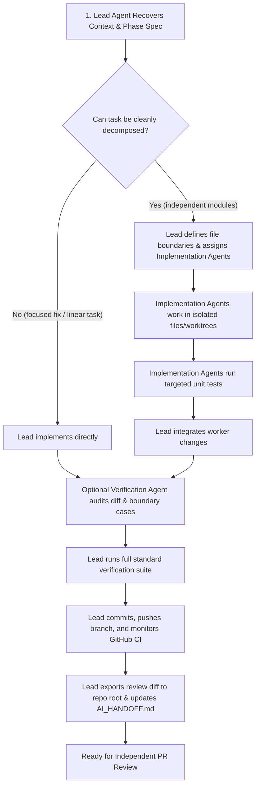

# Multi-Agent Development Workflow

This document establishes the lightweight, permanent multi-agent engineering workflow for Encore. It defines roles, coordination protocols, file-ownership boundaries, and verification standards across all phases and PRs.

---

## 1. Principles & Efficiency Rule

- **Smallest Useful Team:** Default to a single agent for focused fixes, linear tasks, and single-file modifications. Spawn subagents or peer agents only when tasks can be cleanly decomposed into non-overlapping, independent units of work.
- **Parallelize Independent Work, Not Coupled Code:** Split work across independent boundaries (e.g. separate venue adapters, standalone parser vs. independent mock fixtures, documentation vs. isolated tests). Never assign multiple workers to edit the same file or tightly coupled domain models simultaneously.
- **Single Source of Truth:** The Lead Agent owns the primary Git feature branch, remote pushes, GitHub PR management, and final handoff state.

---

## 2. Agent Roles & Responsibilities

### Lead Agent — Coordinator
The Lead Agent acts as the primary orchestrator and sole integrator for the pull request:
1. **Context Recovery & PR Scope:** Recovers repository state, active phase specs, Git status, previous PR dependencies, and handoff notes before assigning work.
2. **Task Decomposition:** Divides the PR objectives into independent tasks with explicit file boundaries and acceptance criteria.
3. **Worker Oversight:** Assigns tasks to implementation agents, monitors execution, and reviews incoming changes.
4. **Integration & Verification:** Integrates worker outputs, runs the full standard verification suite (`format:check`, `lint`, `typecheck`, `test`, `build`), and ensures all tests pass.
5. **PR Management & Handoff:** Pushes commits to the feature branch, verifies GitHub Actions CI (`gh pr checks`), exports the review diff to the repository root, and updates `AI_HANDOFF.md`.

### Implementation Agents — On-Demand Workers
Implementation agents (typically 1–2 per PR when decomposition is beneficial) execute bounded, concrete technical tasks:
1. **Isolated Workspaces:** Work in isolated Git worktrees or conflict-safe subagent workspaces (`Workspace: 'branch'` or `'share'`).
2. **File Ownership Discipline:** Strictly modify only assigned, non-overlapping files. Do not modify shared domain definitions, canonical database schemas, or common utilities without lead coordination.
3. **Focused Verification:** Run targeted test suites (e.g. `npx vitest run tests/unit/<specific>.test.ts`) covering their changes before reporting back.
4. **Coordination Boundaries:** Never push directly to remote branches, never auto-merge, and never alter shared architecture unilaterally.

### Verification Agent — Optional Specialist
For high-risk, multi-subsystem, or architectural changes, an independent verification agent may be invoked:
1. **Code & Invariant Audit:** Evaluates the staged diff against `AGENTS.md` engineering invariants and `PR_REVIEW_CHECKLIST.md`.
2. **Adversarial Edge-Case Testing:** Checks boundary conditions (timezones, malformed payloads, rate limits, RLS boundaries, SSRF/redirect vectors).
3. **Actionable Findings Only:** Reports concrete regressions or defects to the Lead Agent without initiating speculative refactors.
4. **Independence:** Does not replace the human user signoff or the external independent PR review.

---

## 3. Workflow Lifecycle

---

## 4. File Ownership & Boundary Rules

To prevent merge conflicts and state divergence:
1. **Exclusive File Leases:** When invoking multiple implementation agents, the Lead Agent must assign exclusive file lists. For example:
   - Worker A: `lib/sources/venue/velvet-elk/` and `tests/unit/boulder-venues-velvet-elk.test.ts`
   - Worker B: `lib/sources/venue/roots-music-project/` and `tests/unit/boulder-venues-roots.test.ts`
2. **Shared Files Belong to the Lead:** Core registry files (`source-registry.ts`, `data-model.md`, `AI_HANDOFF.md`, `package.json`) and migration scripts must only be edited by the Lead Agent.
3. **Safe Git Operations:** All commands writing to the repository index or worktree must execute cleanly without destructive resets (`git reset --hard`) or force-pushes (`git push --force`).

---

## 5. Verification Gate Before Peer Review

Before declaring a task ready for independent review or user handoff:
1. `npm run format:check` passes without warnings.
2. `npm run lint` reports 0 errors and 0 warnings.
3. `npm run typecheck` passes with zero type errors.
4. `npm test` passes 100% of unit tests.
5. `npm run build` compiles production Next.js artifacts cleanly.
6. GitHub Actions CI checks (`gh pr checks <PR_NUMBER>`) are verified green on the latest commit.
7. Cumulative diff is exported to `./encore-<phase>-<topic>-final.diff` in the repository root.
